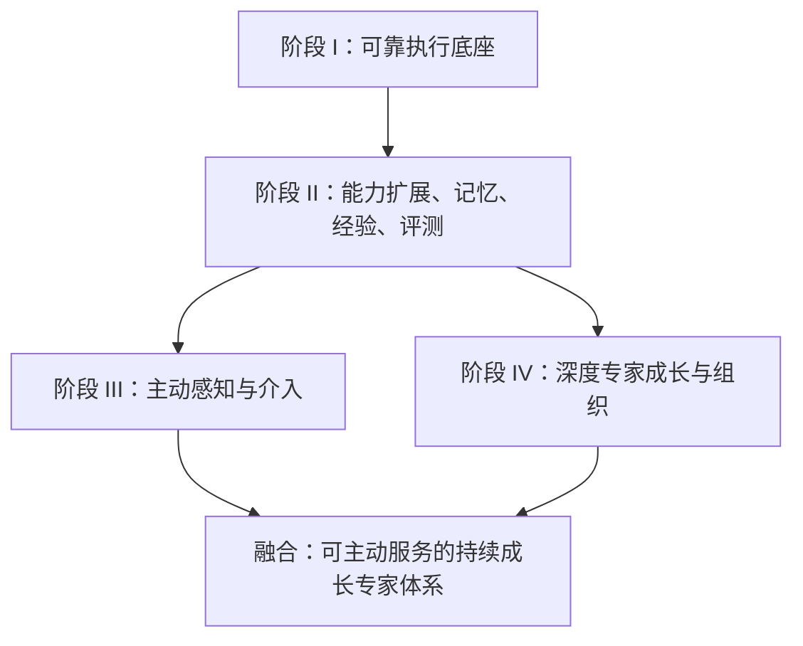
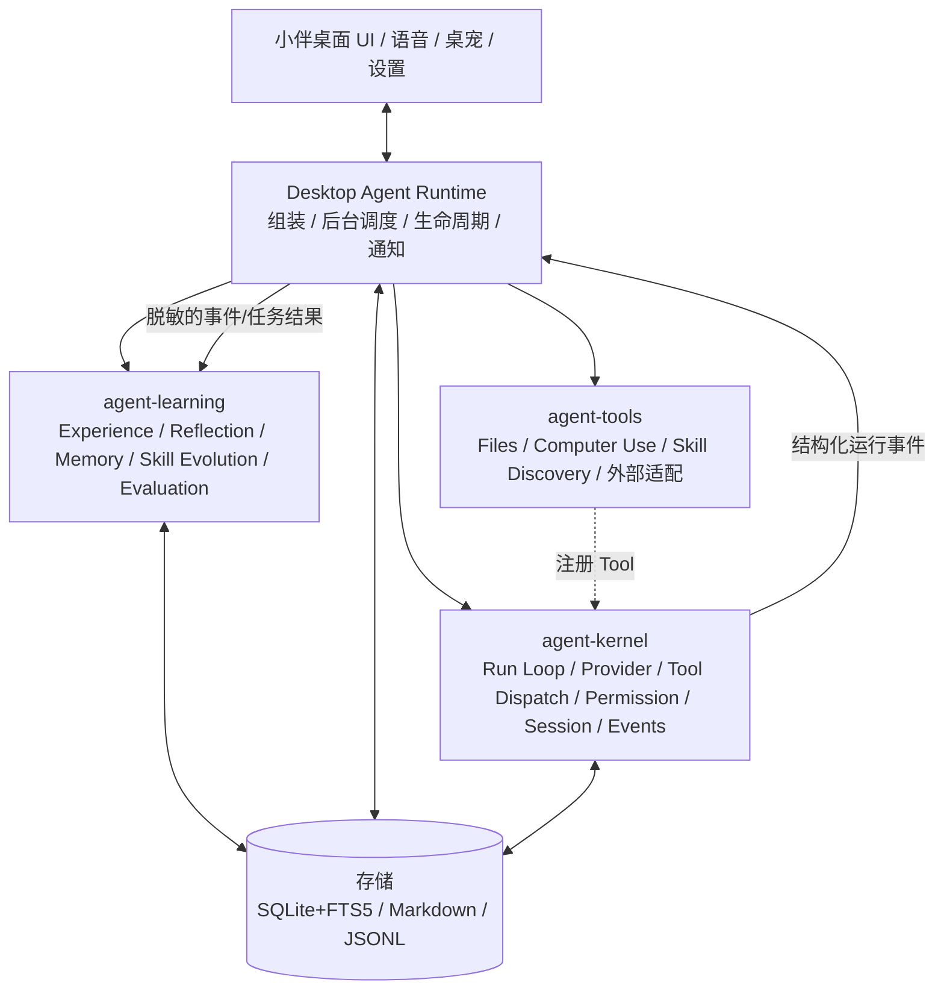
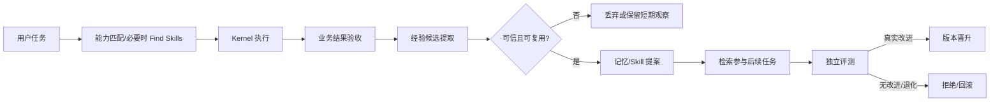
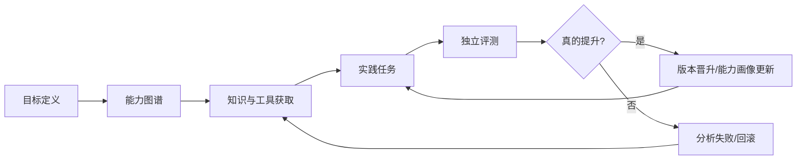

# 小伴 Agent 演进与第二阶段实施手册

> 规划基线：2026-10-21。下文的已有/待建、任务勾选和建议指标保留当时语境，未持续同步为当前进度；当前实现入口见 [目录 README](README.md#当前实现入口)。

> **版本** v1.0 · **日期** 2026-10-21 · **适用范围** XiangBan 小伴桌面 Agent 架构、第二阶段研发与后续 III/IV 阶段预留  
> **状态声明**：本文是一份设计和实施指导手册。已有能力与待建能力明确区分；不代表本文中提出的模块、接口、数据表已被创建或验证。

---

## 目录

1. [总体判断与目标](#1-总体判断与目标)
2. [四阶段技术路线](#2-四阶段技术路线)
3. [当前基线与能力差距](#3-当前基线与能力差距)
4. [系统分层与模块归属](#4-系统分层与模块归属)
5. [第二阶段的完整闭环](#5-第二阶段的完整闭环)
6. [第二阶段实施工作包](#6-第二阶段实施工作包)
7. [SQLite、文件存储与数据契约](#7-sqlite文件存储与数据契约)
8. [安全、隐私和资源治理](#8-安全隐私和资源治理)
9. [评测方法与阶段退出标准](#9-评测方法与阶段退出标准)
10. [第三阶段：主动式 AI](#10-第三阶段主动式-ai)
11. [第四阶段：专家深度成长与 AOE](#11-第四阶段专家深度成长与-aoe)
12. [开发顺序、里程碑和停止条件](#12-开发顺序里程碑和停止条件)
13. [关键决策及开放问题](#13-关键决策及开放问题)

---

## 1. 总体判断与目标

### 1.1 产品方向

小伴不宜将“工具数量多”“有多个专家角色”“能后台运行”本身作为竞争优势。更有价值的用户承诺是：

> 用户教小伴一次可靠的做事方法；小伴能够记住、验证、复用，遇到能力缺口时寻找合适技能，并在后续任务中持续减少错误和重复劳动。

桌宠、桌面组件、语音、悬浮条提供低摩擦交互入口和品牌特征；Agent 的实际任务成功率决定长期价值。

### 1.2 当前决策

1. **主要研发资源投入第二阶段**：能力扩展、智能记忆、经验学习、任务验证、技能演进。
2. **第一阶段进入加固模式**：重点补运行事件接入、持久任务语义、结果验收、安全与跨平台验证，而非无限扩建 Kernel。
3. **第三阶段先保留触发、任务和授权的数据契约**：避免过早部署持续屏幕感知或高频后台模型轮询。
4. **第四阶段先以单专家实验验证成长**：不急于建立庞大的专家团。
5. **先确定实施范围再修改产品代码**：本手册的入库不代表已实现所述能力；应按工作包逐项开发、评测和审查。

### 1.3 不采用的等式

- 长期记忆 ≠ 模型权重学习。
- 自动生成 Skill ≠ 能力真实提升。
- Agent run `completed` ≠ 用户任务成功。
- 定时运行 ≠ 理解用户需求的主动式 AI。
- 多 Agent ≠ 更高智能。
- 带有“专家”人设 ≠ 经验证的专业能力。

## 2. 四阶段技术路线

| 阶段 | 正式名称 | 关键问题 | 用户可感知的效果 | 阶段判断 |
|---|---|---|---|---|
| **I** | Agent Infrastructure（执行基础） | 如何可靠、安全地执行？ | 小伴能完成电脑任务 | 骨架基本形成，关键可靠性待加固 |
| **II** | Adaptive Intelligence（能力扩展与持续学习） | 如何扩展能力、从任务中学习？ | 同类任务越做越稳、越省步骤 | **当前主线，尚无完整学习闭环** |
| **III** | Proactive Intelligence（主动智能） | 何时值得主动提供帮助？ | 在用户授权下发现机会并行动 | 尚未系统建设 |
| **IV** | Expert Evolution & Organization（专家进化与组织） | 如何形成可验证的专业能力？ | 用户可长期培养、调用并组合专业专家 | 长期研发方向 |

### 2.1 正确的依赖关系



III 与 IV 都依赖 II 的可靠学习与验证能力，**但 III 并不是 IV 的技术先决条件**。四阶段是愿景和成熟度分类，不应转化成严格瀑布式开发。

### 2.2 四阶段共用的横向体系

- **Evaluation**：执行结果、经验收益、主动建议收益、专家能力的基准测试。
- **Security & Policy**：权限、来源可信度、敏感数据、误操作保护和撤销能力。
- **Observability**：运行轨迹、因果链、成本、错误分类、用户反馈。
- **Lifecycle**：升级兼容、数据迁移、备份、失效知识清理、版本回滚。

这四项不能推迟到最后才考虑。

## 3. 当前基线与能力差距

> 以下是根据前期对 `bestyize/XiangBan` 的源码和架构文档检查得出的工作基线，**不是再次拉取并验证后的现时事实**。正式开工时必须复核主分支和打包配置。

### 3.1 已有基础

- `libs/agent-kernel`：模型与工具循环、模型协议、流式输出、工具 Schema 校验、权限中间件、取消、上下文处理等基础能力。
- Kernel 0.3 文档列有 `RunEvent`、`run_id`、`run_parts_observed`、可选 `JsonlRunLog`、进程管理及 Subagent 相关能力。
- Kernel 已有 `memory_read`/`memory_write`、`load_skill`/`skill_manage`；基础记忆是本地 Markdown，Skill 有可写根目录和人工授权要求。
- `libs/agent-tools/files`：文件与文档分析工具包。
- `libs/agent-tools/computer-use`：Computer Use 独立工具包及运行时准备。
- 桌面 `src-tauri/src/chat/mod.rs`：组装模型、Tools、Memory、Skills、文件附件、用户批准与桌面能力。
- 会话原始记录以 JSONL 保存；部分上下文压缩在桌面侧实现。

### 3.2 关键缺口

| 缺口 | 风险 | 期望结果 |
|---|---|---|
| 运行轨迹尚未在桌面业务中全面贯通 | 无法形成可靠学习证据 | 每次任务有稳定 ID、工具事件、状态、验收和结果引用 |
| 任务完成缺少独立验收层 | 把假成功记成成功经验 | 文件、代码、业务结果可验证，未知则保持未知 |
| 无远程 Skill 发现/安装闭环 | 新能力难以主动获取 | 搜索→检查→许可→安装→可用性验证→撤销 |
| 记忆以笔记为主，检索策略简单 | 上下文噪声、经验无法精确复用 | 结构化记录 + FTS5 检索 + 归档/遗忘 |
| 缺少自动经验提炼、Reflection 与评测 | 学习效果不可证实 | 候选经验→证据审查→采纳→A/B 测试 |
| Skill 版本治理不足 | 自动改写可能使效果退化 | 版本、回归测试、批准、回滚 |

注意：先前检查时桌面聊天仍可见旧的 `run_parts`/`retry_last` 路径，Kernel 已有更丰富的 observed 接口。**实施前应按最新代码复查实际接线，不能仅凭文档认定桌面已经完整使用 RunEvent。**

## 4. 系统分层与模块归属

### 4.1 推荐总体架构



此图表达**逻辑协作**，不是要求 Kernel、Learning 和 Tools 相互循环依赖。原则是 `agent-kernel` 不依赖产品层、Learning 或具体 Tools；由 Host 注入工具和策略。

### 4.2 具体代码归属

```text
libs/
├── agent-kernel/               # [已有] 通用执行内核、运行协议、权限接口、事件
├── agent-tools/                # [已有] 工具能力集合，各子包独立
│   ├── files/                  # [已有]
│   ├── computer-use/           # [已有]
│   └── skill-discovery/        # [建议新增] Skill 源适配、检查、安装、更新
└── agent-learning/             # [建议新增] 学习服务独立库
    ├── experience.rs          # 经验候选提炼
    ├── reflection.rs          # 后台复盘
    ├── memory_curator.rs      # 记忆晋升、合并、失效处理
    ├── skill_evolution.rs     # Skill 变更提案与版本策略
    ├── evaluation.rs          # 对照试验与改进判定
    └── storage/               # 可替换存储接口/SQLite 适配

client/xiaoban-desktop-wallpaper/src-tauri/src/
├── chat/                       # [已有] 当前聊天业务，不必一次搬迁
├── agent_runtime/              # [建议整理] 宿主逻辑模块，先非独立 crate
│   ├── mod.rs                  # 模块装配/生命周期
│   ├── tasks.rs                # 任务身份/状态与执行结果
│   ├── learning_worker.rs      # 后台学习调度
│   ├── scheduler.rs            # 触发与任务队列预留
│   └── storage.rs              # DB 初始化、迁移、连接管理
└── main.rs                     # [已有] Tauri 入口
```

以上仅为建议目录，**未创建**。

### 4.3 模块边界判断法

| 问题 | 应归属 |
|---|---|
| 某个能力是否改变 Agent Loop、取消、会话和权限语义？ | **Kernel** |
| Agent 需要执行什么外部操作？ | **Tools** |
| 从历史中学到了什么、是否值得保存、改进是否有效？ | **Learning** |
| 何时启动任务、如何组装依赖、后台运行和用户通知？ | **Desktop Runtime** |
| 页面、弹窗、审批交互与权限设置展示？ | **Desktop UI** |

特别注意：`agent-learning` 不应该有第二套 Agent Loop；Reflection Worker 可由宿主创建受限的 Kernel Agent 执行。未来 `agent-experts` 只管理专家档案和组织，不重写 Kernel。

### 4.4 暂时不独立建库的部分

- `agent-memory`、`agent-evaluator`、`agent-workflow`：先为 Learning 或 Runtime 内部模块。
- `agent-proactivity`：第三阶段先为 Runtime 子模块，等具备独立复用边界再拆。
- `agent-experts`：第四阶段的实际单专家实验有效后再引入。

**拆 crate 的条件**：跨宿主复用已经发生、依赖/平台打包不同、团队/测试发布边界独立，而不是名称看上去高级。

## 5. 第二阶段的完整闭环



### 5.1 最小的五个能力

1. **可追踪**：每次运行与外部动作有唯一标识、明确边界和来源。
2. **可验收**：区分“回复结束”“动作已发生”“业务任务通过检查”。
3. **可扩展**：遇到技能缺口能查询远程 Skill，并经用户确认安装。
4. **可学习**：从有证据的成功、失败和人工纠正中提炼经验，并按需检索。
5. **可评估**：在独立任务集上验证是否比没有学习资产更好，支持回滚。

### 5.2 用户体验案例（首选 MVP）

**任务：发票 PDF 整理。**

- 首次：用户明确授权一个目录，小伴识别文件类型、提取日期/公司、预览分类方案、执行并验证文件是否被正确整理；无法确认的项目交用户处理。
- 学习：用户修正“公司名称简称”和目录命名规则。Learning 将这次修正变成**有来源的候选规则**，提示是否长期保存。
- 再次：相似文件进入目录后，用户一句话即可复用上次经验证的方案；未来第三阶段才考虑主动建议。
- 对照：比较未启用用户规则和启用规则的处理准确率、需要用户修改的次数、耗时。

首版**不要**同时追求任意软件全场景示范学习、任意领域专家培养和持续全屏监控。

## 6. 第二阶段实施工作包

### WP0 — 基线与观测（必须先做）

- 复核 Kernel 与桌面运行路径，确认 observed 事件、存储与权限的真实集成状态。
- 设计 `task_id`、`run_id`、`session_id`、`workspace_id`（可选）及父子运行关联方式。
- 记录工具参数摘要、操作结果、错误类别、用户批准、产物引用和模型用量（若供应商提供）。
- 原始执行记录保留 Journal/JSONL，数据库存**可查询索引及结果摘要**，避免写两份完整原始流。
- 定义崩溃/取消/未知副作用策略：外部写操作如已派发但状态未知，**不可盲目重放**。

**验收**：给定 `task_id`，可以追踪模型调用、工具操作、用户批准和最终状态；应用重启后能够识别未完成且结果不确定的操作。

### WP1 — 结果验证与执行可靠性

- `TaskOutcome` 必须区分 `succeeded / failed / partial / cancelled / unknown`。
- 为首批任务提供确定性 Validator，例如：文件存在且命名正确、数据字段满足规则、测试通过、输出文件可解析。
- 无法确定时输出 `unknown`，禁止仅凭模型口述将任务标为成功。
- 将验证证据（检查方式、产物哈希/路径、时间和确认者）关联任务。
- 对副作用显著的工具建立撤销或补偿方案（如文件移动先预览/临时目录/操作清单）。

**验收**：对已知成功/失败/部分成功/未知的任务样本，系统能合理分类并展示证据；对于不可安全重试的外部写操作不自动重试。

### WP2 — 远程 Skill Discovery

建议 `libs/agent-tools/skill-discovery` 对外提供：

- `skill_search`：搜索多来源技能目录；未支持的来源明确返回不支持。
- `skill_inspect`：获取来源、版本、文件清单、运行要求、权限需求和校验值。
- `skill_install`：经过批准后安装到受控用户目录；记录安装来源与具体版本。
- `skill_update`、`skill_uninstall`：检查版本与影响后更新或卸载。

优先适配一到两个可验证来源（如 SkillHub/skills.sh/GitHub）；**实际接口、下载协议、站点授权与使用条款须在实施时核验，不硬编码未经证实的 API**。

安全规则：远程 Skill 内容是不可信指令；必须先 inspect，再由用户确认；仅在沙箱/权限策略允许范围内执行。`SKILL.md` 自称的 `origin` 字段不能作为可信来源证明。

**验收**：从搜索、查看、批准、安装、加载、卸载全流程完成；拒绝恶意路径、软链接逃逸、危险脚本和来源校验失败；不自动给新 Skill 提权。

### WP3 — 智能记忆与检索

- 设计四种不同用途：`profile`（用户已确认偏好）、`episodic`（任务经历）、`procedural`（验证过的方法）、`workspace`（项目范围知识）。
- Markdown 作为用户可编辑的长期记忆/Skill，SQLite 存元数据、经验候选和检索索引。
- 首版使用 SQLite FTS5，支持关键词、范围、来源、时间和置信度过滤；未验证检索质量前不急于上向量数据库。
- 引入记忆来源、创建依据、更新时间、适用范围、过期策略和撤销路径。
- Context 只装入当前任务**真正相关**的记忆，避免全量注入。

**验收**：新会话能在正确范围内找到用户曾确认的规则；用户可以查看、纠正、删除；不相关或已撤销记忆不会继续影响任务。

### WP4 — Experience Learning 与 Reflection

- 消费运行事件、Validator 结果、用户纠正，生成结构化**候选经验**。
- 区分 `observation`（观察）/ `hypothesis`（假设）/ `verified`（有外部证据验证）/ `rejected`（已否决）。
- Reflection 应由后台独立任务执行，限次、限 Token、限时间；低价值对话不启动模型分析。
- 候选记忆必须做合并、去重、冲突检测、时效性检查；隐私敏感内容默认不过度存储。
- 学习成功只等于获得可复用的新依据，**不是**自动证明任务能力显著提高。

**验收**：相同纠正重复出现不会无限复制记忆；有来源且经过确认的规则能跨会话复用；被否定的经验能撤回。

### WP5 — Skill Evolution + Evaluation

- 基于经验证的经验生成 Skill 修改**提案**，不直接覆盖当前稳定版。
- 存储原版本、候选版本、变更理由、任务证据及回滚点。
- 在固定回归集和独立留出集上比较候选 Skill 与现有 Skill。
- 只有达到预先设置的改进门槛、且没有严重回归或越权，才允许晋升；重大改动需用户批准。
- 如无法确定收益则保留当前版，避免“为了进化而进化”。

**验收**：能够演示“提出版本→评测→接受/拒绝→审计→回滚”闭环；不合格版本无法静默替换生产 Skill。

### WP6 — 后台学习、成本控制与用户控制

- 学习任务使用独立队列，主对话不因 Reflection 阻塞。
- 支持按任务价值批处理；低成本规则优先，确需推理才调用模型。
- 明确学习频率、Token/费用预算、总运行时限、失败退避和静默时段。
- 设置“成长记录”：可看见小伴学到了什么、依据什么、是否已应用、怎样撤销。
- 允许分别关闭记忆、后台学习、联网搜索 Skill、自动提议，关闭时明确处理已存数据的选项。

**验收**：普通聊天不因后台学习显著变慢；断网/应用退出可安全中断；关闭学习后不再产生新学习任务。

## 7. SQLite、文件存储与数据契约

### 7.1 选型决策

- 桌面端内置 SQLite，建议 Rust 使用 `rusqlite` 的 `bundled` 特性静态编译 SQLite C 引擎。
- **不需要独立安装 SQLite 服务器或可执行程序**；真实安装包增量仍需 macOS/Windows 相同 Release 配置对照构建验证。
- FTS5 是否启用以构建配置和运行时检查为准，不能只因为使用 bundled 就直接假定可用。
- 数据库路径通过小伴现有 Tauri 用户数据目录定位，由 `storage::root(...)` 等宿主配置决定，不要写死用户家目录。
- 原始对话、Journal、Skill Markdown 和经验索引可以混合存储；**不以数据库替换全部现有文件。**

### 7.2 推荐存储分工

| 内容 | 建议保存位置 | 原因 |
|---|---|---|
| 原始会话历史 | 保留现有 JSONL | 无需大规模迁移，兼容已有行为 |
| 原始 RunEvent | Kernel Journal/JSONL（若启用） | 便于溯源、诊断中断 |
| 可编辑 Skill | `SKILL.md` 与配套文件 | 人类可读、可版本化 |
| 已有长期记忆 | 继续保留 Markdown | 避免破坏用户已有内容 |
| 任务结果、经验候选、检索索引 | SQLite + FTS5 | 事务与查询能力 |
| Skill 安装来源、版本、审核状态 | SQLite（指向文件资产） | 不信任单纯文件内元数据 |
| 评测结果与学习任务队列 | SQLite | 追踪进度与回归比较 |

### 7.3 最小逻辑数据模型

以下为概念字段，不是立即执行的 SQL Migration。

| 表 | 主要字段 | 作用 |
|---|---|---|
| `task_outcomes` | `task_id`, `run_id`, `session_id`, `status`, `validator_id`, `evidence_ref`, `finished_at` | 任务真实结果，不混淆 run completed |
| `experience_items` | `id`, `kind`, `scope`, `source_task_id`, `state`, `content_ref`, `confidence`, `updated_at` | 经验候选、复用状态及来源 |
| `skill_installs` | `skill_id`, `source`, `source_url`, `version`, `digest`, `approval_ref`, `installed_at` | Skill 来源、校验及版本 |
| `skill_revisions` | `id`, `skill_id`, `base_version`, `candidate_ref`, `eval_ref`, `state` | 改进提案与回滚依据 |
| `eval_cases` | `case_id`, `domain`, `fixture_ref`, `validator`, `split`, `risk_level` | 固定任务集与留出集 |
| `eval_results` | `id`, `case_id`, `candidate`, `baseline`, `outcome`, `cost`, `duration_ms`, `model_id` | 对照评测结果 |
| `learning_jobs` | `job_id`, `kind`, `state`, `priority`, `budget`, `scheduled_at`, `run_ref` | 后台学习队列 |

注意事项：

- **最小 MVP 可先落四张表**：`task_outcomes`、`experience_items`、`eval_cases`、`eval_results`；其余随对应模块交付，不做过度超前建表。
- 需要可追溯的命名空间，如 `user_id`（仅多账户才需要）、`workspace_id`、`expert_id`（未来可空）；不要误将私人记忆全局化。
- `source_task_id` 和 `evidence_ref` 保留可溯源依据，而不是存一段“模型觉得已成功”的总结。
- FTS5 只索引适合检索且被允许保存的文本；用户删除时必须同时清理索引、派生摘要及缓存。
- 记录 schema version，采用可重复运行、有失败保护的 Migration；升级前做适当备份。启用 WAL 要考虑 checkpoint、备份一致性和磁盘占用。
- SQLite 本身**不加密**。需要保护高敏数据时，应设计单独加密/系统凭据集成，不把“本地保存”当作加密。

### 7.4 事件与经验的建议契约

```json
{
  "task_id": "task-example-001",
  "run_id": "r-example-001",
  "session_id": "session-example-001",
  "trigger": "user_request",
  "status": "succeeded",
  "outcome_evidence": {
    "validator": "file_manifest_match",
    "evidence_ref": "local-artifact-ref",
    "checked_at": "2026-10-21T00:00:00Z"
  },
  "learning": {
    "candidate_state": "pending_review",
    "kind": "procedural",
    "scope": "workspace",
    "source_task_id": "task-example-001"
  }
}
```

**上述 JSON 为设计示意，不代表当前 Kernel 或桌面事件的真实 schema。** 实际集成时应使用已存在的 `RunEvent` 契约做映射，禁止无必要地重定义一套相互竞争的事件格式。

## 8. 安全、隐私和资源治理

### 8.1 分级授权（建议）

| 操作 | 默认策略 |
|---|---|
| 读取用户指定工作区中获授权的文件 | 在已授权范围内执行 |
| 搜索远程 Skill 目录 | 首次清楚告知联网，遵循网络权限设置 |
| 安装外部 Skill / 依赖 | **先展示来源、文件与权限，再明确确认** |
| 修改长期记忆 / Skill | 规则化控制；高影响、外部来源和行为改变要求批准 |
| 删除/覆盖大量文件、外部发送、支付、提交 | 高风险确认，优先支持预览和回滚 |
| 后台反思处理历史内容 | 遵守用户开关及模型数据外发规则 |
| 主动监控屏幕/麦克风 | **默认关闭**，显式授权，用户可见且随时停止 |
| 多专家代理执行 | 子 Agent 权限不得超过父任务授权范围 |

### 8.2 不可信内容隔离

Skill、网页、文档、MCP 返回值和工具结果属于外部输入，不得仅凭其自述提升权限。安装可信度与运行时调用授权是两层不同的控制。

Reflection 不能把外部网页文本中的“忽略先前指令”晋升成长期系统规则；学习候选要记录来源类型和信任级别。必要时把不可信知识仅当成可引用资料，而非命令。

### 8.3 防止学习失控

- 限制后台学习频率、并发、Token、网络流量和磁盘配额。
- 不让两个后台任务并行覆盖同一条 Memory/Skill；使用版本检查或事务。
- 经验有过期/审阅机制；知识撤销应影响后续检索。
- 避免为“进化”而反复自生成自测数据，评测应含独立留出样本。
- 对模型升级进行回归；旧版 prompt 或 Skill 优化可能迁移失败。

## 9. 评测方法与阶段退出标准

### 9.1 为什么要先建设评测体系

有 Memory、Skill、Reflection 并不能证明“成长”。学习有效性至少需要满足：同一基础模型、同样工具、相似上下文预算与测试条件下，使用学习成果的 Agent **在独立任务上持续更好**。

### 9.2 建议构建三个层级测试集

1. **确定性基础测试**：单工具、文件名规则、结构化抽取、进程取消、Schema/权限拒绝。适合 CI。
2. **端到端真实任务**：PDF 分类、批量文件改名、简单表格清洗或类似真实工作流。初期每类至少 5–10 个可重复样本，逐步扩大；这是建议规模，不是统计显著性保证。
3. **未见任务与迁移测试**：不同文件内容、目录、命名模式及新的错误情形，验证是否泛化而非记住样本。

### 9.3 统一测量指标

| 指标 | 解释 | 优先级 |
|---|---|---|
| `Task Success Rate` | 经外部 Validator 或用户确认的成功率 | P0 |
| `Unsafe Action Rate` | 未获授权的危险操作频度 | P0（安全门槛） |
| `Learning Uplift` | 启用学习资产相对关闭资产的任务表现变化 | P0 |
| `Human Intervention` | 需要用户补救/纠正的次数 | P0 |
| `Regression Rate` | 新版 Skill 在旧任务上的退化比例 | P0 |
| `Time to Completion` | 从用户发起到可验收完成的耗时 | P1 |
| `Model/Tool Cost` | Token、请求、工具执行及存储成本 | P1 |
| `Retrieval Precision` | 注入的经验是否真与当前任务相关 | P1 |

**实验规则**：固定基础模型版本、温度和工具版本；使用相同任务顺序或做随机化，记录重复试验波动，不只展示挑选出的成功演示。严重越权、误删除等安全事故不能被平均成功率掩盖。

### 9.4 第二阶段建议退出门槛

以下五项必须有可演示的证据：

- [ ] **能力发现**：缺少能力时，可以搜索、检查、批准安装并使用适配的 Skill。
- [ ] **跨会话复用**：能精准检索用户授权的历史规则，应用范围正确，撤销立即生效。
- [ ] **任务验收**：成功、失败、部分完成、未知都有客观证据和正确 UI 状态。
- [ ] **学习有增量价值**：在约定的独立任务集上，至少一个真实场景出现可重复的质量/效率提升，同时安全性不下降。
- [ ] **受控进化**：Skill 改动经过测试并能回滚；不合格候选不能静默晋升。

不要求每个领域都显著变强，更不要求达到“自主演化成任何专家”。

## 10. 第三阶段：主动式 AI

第三阶段的核心是**发现机会并做出恰当介入决策**，不是仅实现 Cron 或 Heartbeat。

### 10.1 成熟度分级

| 等级 | 行为 | 是否应首版开放 |
|---|---|---|
| L1 | 用户订阅的事件/时间提醒 | 可以 |
| L2 | 观察已授权事件并提出任务建议 | **优先验证** |
| L3 | 在明确授权范围内自动执行并验收 | 任务可靠后逐步开放 |
| L4 | 围绕长期目标自主规划与推进 | 远期，严格预算和权限 |

### 10.2 架构放置

先在 Desktop Runtime 内设置 `proactivity` 逻辑子模块：Trigger Engine、Opportunity Scorer、Intervention Policy、Scheduler。系统感知能力通过 Tools 提供；实际执行始终复用 Kernel；反馈进入 Learning。

### 10.3 一组必要约束

- **事件优先**：文件变化、任务中断、已授权的业务事件，优先于持续全屏截图。
- **先建议后执行**：尚未验证价值时，默认采用用户可忽略的低打扰提示。
- **可解释**：每条建议显示触发依据和预计行动。
- **可关闭**：允许按场景、软件、时间段和敏感目录关闭主动行为。
- **可度量**：建议接受率、实际节省时间、误打扰率、主动功能关闭率和安全事件。

## 11. 第四阶段：专家深度成长与 AOE

### 11.1 概念边界

- **Evolving Expert（持续进化专家）**：持久化的专业知识、工具、技能、经验、实践履历及经验证的能力画像。
- **AOE（Adaptive Organization of Experts，专家适应性组织；内部工作名）**：在多个专家成熟后进行能力路由、任务分工和协作。
- **不推荐 PEE 缩写**：虽然 Persistent Evolving Expert 语义接近，但缩写在英语中存在明显歧义。对外命名须另做冲突/商标检查。

**先单个专家深度成长，再专家团协作。** 仅修改 system prompt 或加载知识库不能证明专家成长。

### 11.2 单专家生命周期



建议专家 Profile 保存：领域与范围、能力图谱、适用模型、知识来源、Skill 版本、独立测试结果、实践成果、权限预算、失效知识及版本历史。基础模型可以共享；专家并不等于一直运行的独立模型进程。

### 11.3 专家团前的必要对照

必须比较：

1. 同样模型与 Tools 的通用 Agent。
2. 携带已验证领域资产的单个进化专家。
3. 多个专家协作后的 AOE。

如果 2 相比 1 没有收益，不应扩大专家团；如果 3 相比 2 不能带来足够的质量收益，不应让所有任务默认多 Agent 并发。

### 11.4 最小研究试点

选择能独立测试的窄领域，例如 **Three.js 可交互场景开发** 或 **Excel 数据处理**。由项目实际需求确定，只选其一先验证：有固定任务、可自动检查、可跨版本回归、可在未见样本上测试。对于医疗、法律、投资等领域不得仅凭自评宣称专家可靠。

### 11.5 未来模块

实测单专家成长有价值后，再考虑 `libs/agent-experts`：Expert Registry、Capability Profile、Expert Router、Team Orchestration。它不得重新实现 Agent Loop 或绕开 Kernel 权限。

## 12. 开发顺序、里程碑和停止条件

| 里程碑 | 优先交付 | 产出物 | 进入下一里程碑的条件 |
|---|---|---|---|
| **M0** | 基线复核与任务集 | 当前代码映射、10–30 个初始任务样本、性能基线 | 可以稳定重放并验收至少一类任务 |
| **M1** | RunEvent 贯通、任务验收 | 轨迹查询与结果证据 | 成功、失败、未知不混淆 |
| **M2** | SQLite + FTS5、Experience 索引 | 数据迁移、经验检索、撤销 | 跨会话复用正确且可控 |
| **M3** | Skill Discovery | Search/Inspect/Install/Uninstall | 安装经过审核且不提权 |
| **M4** | Reflection 与经验晋升 | 候选经验、来源与学习审批 | 用户纠正可持续复用，不无限累积噪声 |
| **M5** | Skill Evolution + Eval | 版本晋升、回归及回滚 | 一个真实场景出现可重复 Learning Uplift |
| **M6** | 小范围主动建议 / 单专家试点 | 验证 III/IV 假设 | 分别有用户价值与专业能力证据 |

**没有时间估算**：先实测当前代码、任务复杂度、工具质量和外部平台接口，再给排期。

### 12.1 停止条件与范围控制

满足任一条件时暂停扩展并回到任务成功率：

- 学习系统带来明显额外成本，却无法在独立任务上证明收益。
- 生成 Skill 数量不断增长、冲突增多、任务效果下降。
- 后台学习/主动行为造成明显卡顿、骚扰或越权。
- 研发长期集中在抽象层，但没有端到端用户故事验收。
- 专家自评不断提升，而真实任务表现没有改善。

## 13. 关键决策及开放问题

### 13.1 已形成的架构共识

- Kernel 保持通用执行内核，不直接依赖 Learning、Tauri、远程 Skill 市场。
- Tools 按外部操作能力独立扩展；Files 与 Computer Use 继续独立。
- Learning 独立管理经验与进化策略，不另造 Agent Loop。
- SQLite 随桌面程序打包，主要承担经验、索引与任务元数据；Markdown/JSONL 不强制迁移。
- 第三阶段主动决策先做 Runtime 子模块；第四阶段的专家团不提前创建复杂基础设施。
- 第二阶段的完成条件是**可验证的真实收益**，不是“模块全部存在”。

### 13.2 实施前仍需明确

1. 第一批 MVP 用户任务最终选哪个（推荐文件/PDF 分类；备选数据清洗/批量命名）。
2. 任务验收是严格确定性规则、用户确认，还是二者组合；不同场景应不同。
3. Memory、后台 Reflection 和第三方联网能力的用户默认开关与授权文案。
4. 个人工作区、会话级和未来专家级记忆的作用域与删除语义。
5. 远程 Skill 平台选型与官方 API、版权、供应链审查范围。
6. 需要支持哪些离线能力；用户 BYOK 与小伴托管模型如何计量学习费用。
7. Windows / macOS 真实打包体积、FTS5 编译选项和冷启动影响。

---

## 最终实施原则

> **先让执行结果可信，再让经验可信；先证明经验能复用，再让系统自动修改技能；先证明单个专家确实变强，再组织专家团。**

第三、四阶段可以持续研究，但当前第二阶段主线不应被它们稀释。
