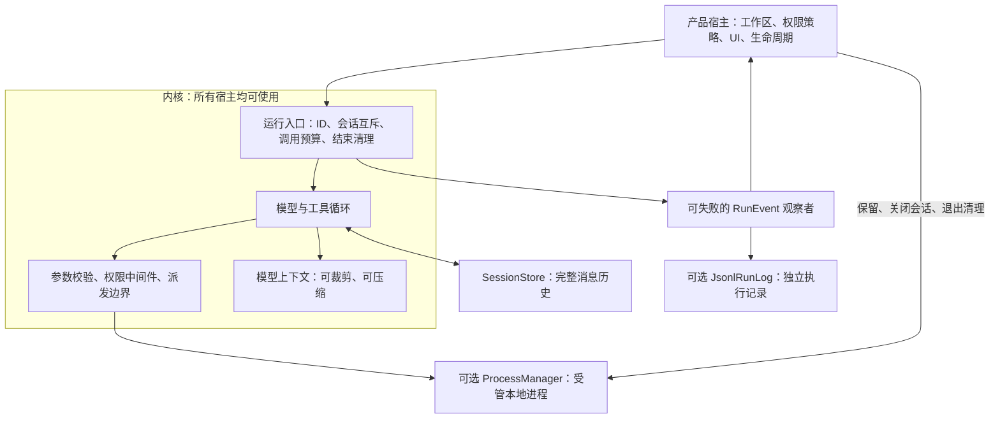

# Agent 运行与进程基础（0.3）

日期：2026-10-24。本文描述已实现的接口。持久目标、同机跨进程会话锁、父子共享预算和可选启动恢复已接入，见 [长期目标架构](durable-goals.md)。没有独立后台任务队列或任意进程的重启恢复。

## 职责与数据边界



会话是长期对话；run 是本次输入触发的一次循环。`RunEvent` 独立于消息历史，不进入模型上下文。模型上下文可以被裁剪，执行记录不随之裁剪。当前授权仍由宿主装配的 Permission/策略处理，不从摘要或执行记录里恢复授权。

## 运行协议

新增入口：`run_parts_observed`、`retry_last_observed`，接收 `RunOptions` 和 `FnMut(RunEvent) -> Result<(), HarnessError>`。原 `run`、`run_parts`、`retry_last` 保留。

每次运行生成新 `run_id`；同一次运行的事件带 `session_id`、可选 `parent_run_id`、从 1 开始的连续 `sequence`、UTC 毫秒时间。序号用于排序，时间戳不承担单调时钟保证。

状态为 running、completed、paused、failed、cancelled。completed 只表示模型循环正常结束，业务验收需要宿主另行定义。续跑保护、轮数或调用预算触顶属于 paused；提问和批准仍沿用现有宿主交互，尚未建成可持久化等待状态。

`RunOptions.max_tool_calls` 限制本次请求的工具调用数，包括参数无效、被拒绝和截断的调用。超过剩余额度的一整批都会被拒绝，并保存对应错误结果后暂停，不执行批次的一部分。桌面交互默认不设置轮数和调用次数上限，可在执行设置中配置；子任务共享父级工具预算和 RunControl 的时间/token 预算。

工具请求先发 ToolStart，参数校验和权限检查通过后发 ToolDispatched，随后检查取消并派发。ToolDispatched 是执行意图边界，不能证明动作已发生。观察者可在这个边界完成同步记录；观察失败时内核设置取消，禁止继续派发。

`ToolCtx.run_id()` 可供工具关联资源。`Tool::on_run_end` 在终止事件之前释放资源，必须幂等；清理失败或终止记录失败时可能再次按 failed 状态清理。被会话互斥拒绝的运行不会清理另一次运行的资源。同步中间件和第三方工具仍需配合取消；进程工具的取消能力不代表可强制终止任意 Rust 工具线程。

`RunOptions.ephemeral_session` 用于子任务的临时运行资源，与 SessionStore 的对话保留策略分开。内置 Subagent 自动关联父 run，启用临时会话清理，并支持 `observe_run`；旧 `observe` 回调保持原事件视图。

## 可选执行日志

`journal` feature 提供 `JsonlRunLog`。宿主在观察者中先调用 `append`，成功后再转发 UI 事件。日志路径由宿主提供，文件记录格式为 `{ "v": 1, "event": ... }`；不写入任何全局固定路径。

- 一次运行一个文件。首条记录独占创建文件，后续校验身份与连续序号，终态后不能继续追加。不提供跨进程的同会话互斥。
- Unix 文件权限为 0600。状态和工具边界执行 sync_data；文本增量不逐块同步，在后续边界一起同步，避免每个流式片段都刷盘。
- `read_after(run_id, sequence, limit)` 支持游标补读，一页最多 100 条；`inspect` 返回末次记录状态与未配对的工具。尾部半行忽略，中间损坏、未知版本和身份/序号异常返回错误。
- 未配对的派发动作只报告“不确定”，从不自动重放。running 是末次持久状态，不代表生产进程仍存活。重启识别和恢复决定归宿主后续运行服务。
- 日志包含对话事件和工具参数，保存在宿主私有数据区，不是遥测。宿主负责脱敏、保留策略和清理；大产物独立存储接口后续再引入。

最小接入示意：

```rust,ignore
let log = JsonlRunLog::new(host_run_directory);
let result = agent.run_parts_observed(
    "conversation-1", input_parts,
    RunOptions { max_tool_calls: Some(100), ..Default::default() },
    &mut |event| {
        log.append(&event)?;
        send_to_ui(event);
        Ok(())
    },
    &cancel,
);
```

## 可选进程管理

`process` feature 提供 `ProcessManager`，不依赖 Tauri、模型协议或网络库。宿主为一个工作区保留一个 manager，工具为 process_start、process_read、process_write、process_stop。

| 能力 | 约定 |
| --- | --- |
| 启动 | 在固定工作区用 sh/cmd 执行前台命令，立即返回句柄；默认执行风险、串行，经宿主权限策略处理 |
| 日志 | 合并 stdout/stderr，默认保留最近 256 KiB；用 next_cursor 读取新增内容，dropped_bytes 报告淘汰量，正常 UTF-8 不在分页边界丢字 |
| 等待 | process_read 可聚合等待最多 60 秒，进程退出时提前返回，等待可取消；运行中的有等待读取不算无进展，零等待空轮询仍受保护 |
| 输入 | 管道输入，单次最多 8 KiB，可关闭 stdin；不提供 PTY。输入调用超时/取消时终止目标进程，以解除阻塞的写入 |
| 停止 | Unix 使用进程组，Windows 使用 Job Object，配置失败不静默降级。停止未确认时返回错误，不声称成功 |
| 资源 | 默认同时运行最多 8 个、保留最多 64 个记录，淘汰已结束的最旧记录；默认工具运行 600 秒，宿主最大时限默认 3600 秒，可配置 |
| 环境 | 清空后仅继承基础路径、用户目录、语言和临时目录；宿主可显式配置 env/inherited_env，不自动继承模型凭据 |
| 所有权 | 句柄绑定 manager 的工作区与调用会话；其他会话或 manager 即使知道 ID 也不能读取、写入或停止 |

默认 scope=run，结束回答时清理。`keep_alive=true` 是 scope=session，只在本次正常完成后保留；取消、暂停、失败仍清理本次创建的进程。子 Agent 临时会话结束会清理其 session 资源。宿主应在删除会话时调用 forget_session，退出时调用 shutdown；manager 丢弃也会请求清理。进程身份含时间、进程号和序号，避免应用重启后旧句柄指向新进程。

命令仍以宿主用户权限执行，工作目录与环境白名单不构成沙箱。Unix 脱离进程组的进程、Windows 子进程创建与 Job 归属，以及操作系统不可中断状态有平台限制；Windows 当前仅做交叉编译检查，仍需实机验证。未实现 PTY、跨应用重启重新挂接进程、容器或远端执行。

如果安装 RepeatGuard，建议忽略 process_read 这类合法轮询工具；总调用预算仍生效。

```rust,ignore
let processes = Arc::new(ProcessManager::new(workspace)?);
for tool in processes.tools() { builder = builder.tool_arc(tool); }
builder = builder.middleware(RepeatGuard::new().ignore_tool("process_read"));
// 宿主持有 processes；会话删除和应用退出时主动清理。
```

## 桌面与 stdio 接入

小伴桌面缓存按工作区创建的 manager，每次聊天装配同一工作区的进程工具。process_start 共用 Shell 的危险命令检查；process_write 在完全信任模式下也要求人工确认。新事件经脱敏写入 `chat/runs/<session>/`，随后发送到 UI；旧 chat-event 额外携带 runId、sequence、timestampMs，运行状态单独通过 chat-run-state 发出。UI 当前不提供运行历史补读界面。删除会话会先清理进程，再删除对应执行记录和消息。

stdio v1 的旧请求仍返回原 event/run_end 帧。hello 增加可选 capabilities；客户端可用 `observed: true` 选择 run_event 帧（record 为 RunEvent），并用 max_tool_calls 限制本轮调用。该模式的 run_end 额外带内核 run_id。旧模式不插入新 ToolDispatched 事件。

独立参考宿主 `examples/stdio_agent.rs` 无 Tauri 依赖；编译启用 process 后，显式设置 AGENT_ALLOW_PROCESSES=1 才注册进程工具，并沿用客户端批准。stdin 结束后宿主退出，会释放 manager。真实模型与干净用户机器的运行时准备另行验收。
