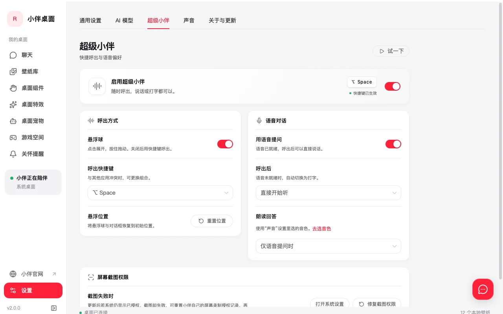
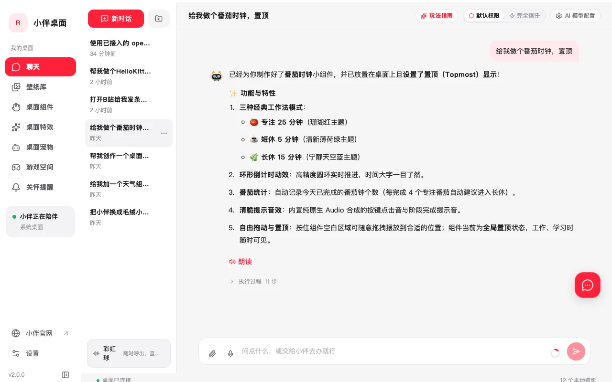
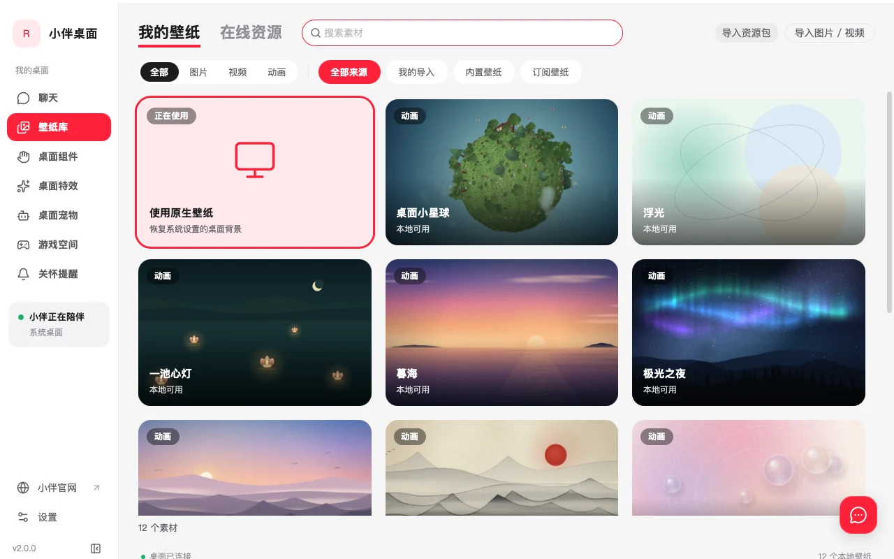
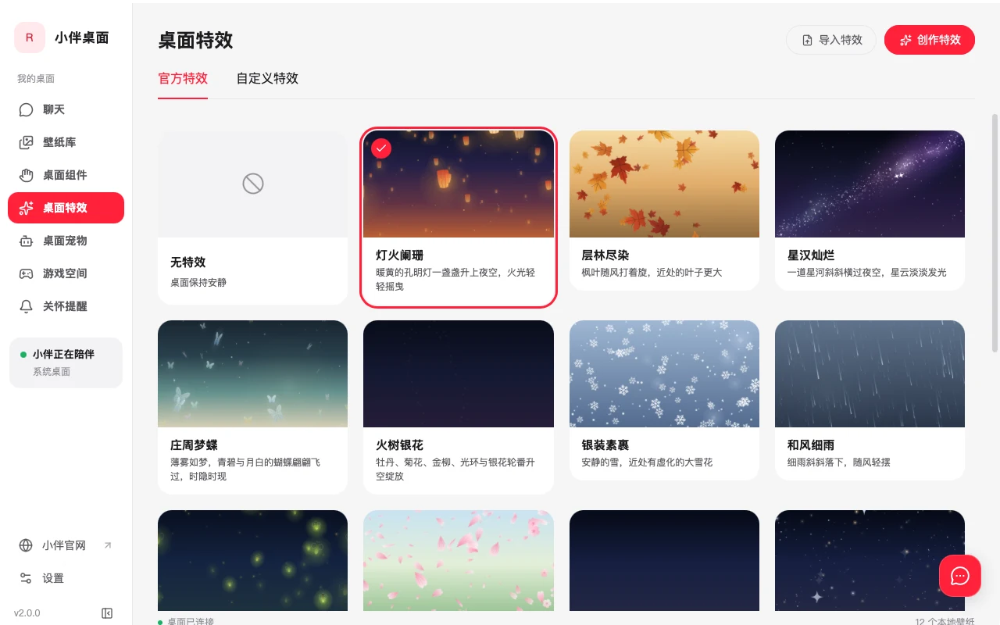
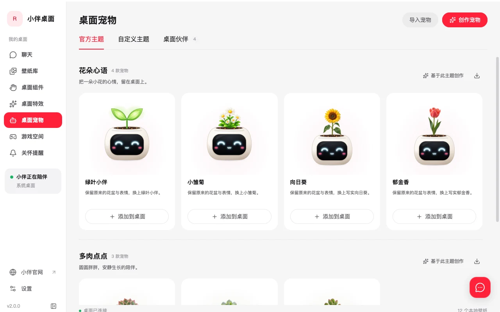
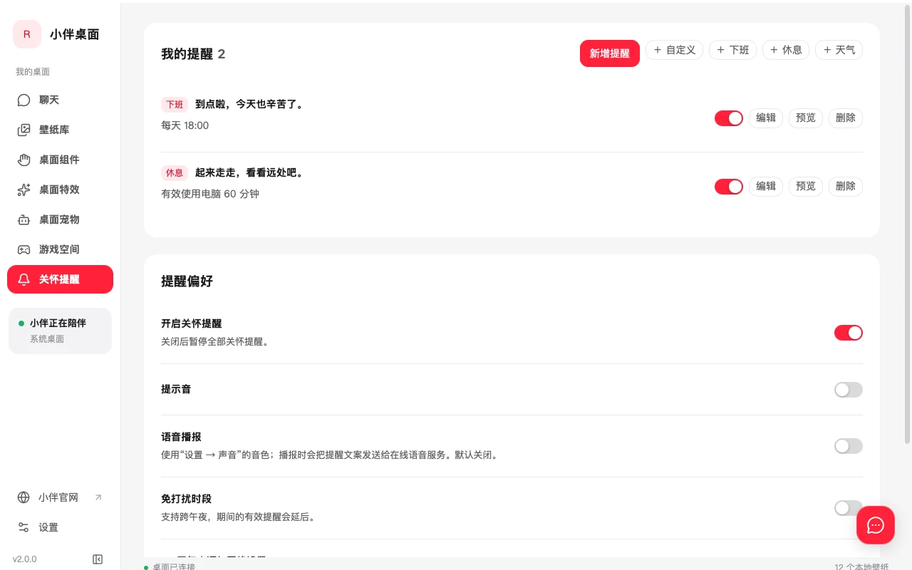
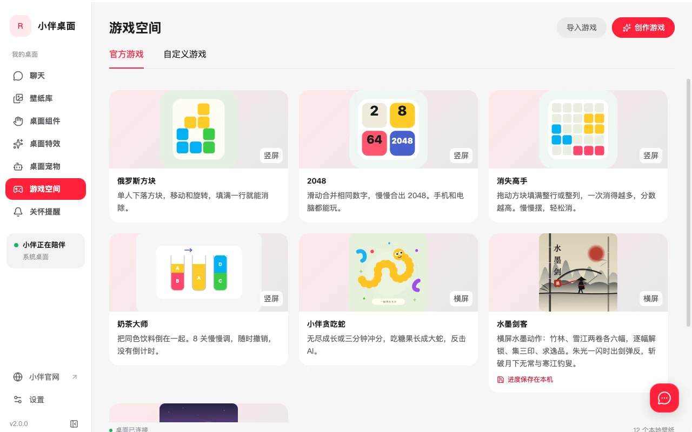
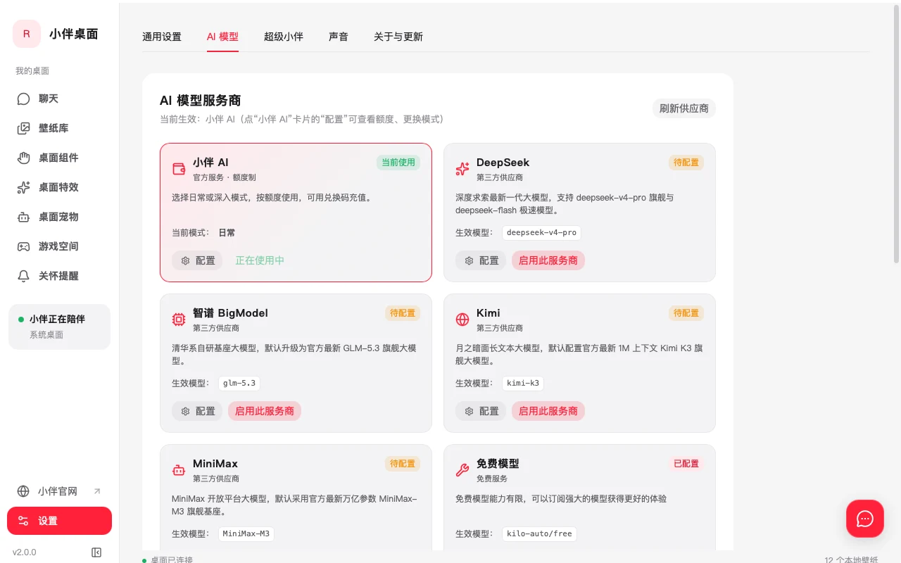

# 小伴桌面 · 产品介绍

> 你的桌面生活空间。一句话，办点事；一抬眼，好风景。
>
> 平台：Windows 10/11（64 位）、macOS 12+（Apple 芯片）。截图来自 macOS 实机控制台的浅色主题，素材位于 [services/server-xiaoban/web/public/desktop](../../services/server-xiaoban/web/public/desktop/)。实现状态与平台限制以[客户端 README](../../client/xiaoban-desktop/README.md) 为准。

## 一句话

一个随时叫得出来的桌面助手，和一盆会回应你的小植物。对它说一句话，就能查资料、整理文件、换壁纸、做特效、摆组件、设提醒，甚至操作电脑。

## 超级小伴

按下 Alt+Space，或点一下屏幕边缘的悬浮球，就能在任何应用里展开对话。语音在本机转成文字，回答可按偏好朗读；快捷键、呼出方式和朗读偏好都能调整，需要长聊时再进入完整聊天。

## 亮点

### 1. 说一句话，桌面就变了

内置通用桌面 Agent。对小伴说“给我做个番茄时钟，置顶”，它会自己写好组件、保存到自定义组件、放到桌面并设为始终可见，回答下方还能展开执行过程。换壁纸、做特效、摆组件、设提醒也一样。

- 能控制小伴桌面本身：换壁纸、开关特效、创作新特效、摆放组件、换外壳与表情、增删提醒、打开游戏。
- 也能帮你办事：在工作目录里读写文件、搜索、运行命令、查网页、做任务清单，并记住你的偏好。
- 默认权限下读操作自动，写文件和运行命令前先问你；“完全信任”模式只在高风险操作（提权、删库、强推等）时才停下来确认。
- 可选开启电脑屏幕与应用控制。

### 2. 动态壁纸，铺满桌面

在线壁纸库提供精选图片与循环视频，也能导入自己的 PNG、JPEG、WebP、GIF 和 MP4。保存后离线可用，随时调整画面适配与视频速度，想回到系统壁纸一键恢复。壁纸位于桌面图标之下，不挡你的文件。

### 3. 十二种桌面特效

灯火阑珊、层林尽染、星汉灿烂、庄周梦蝶、火树银花、银装素裹、和风细雨、萤火之光、落樱缤纷、流星赶月、星罗棋布、流光溢彩。特效是壁纸之上的独立一层，换壁纸照常显示，鼠标点击直接穿过。密度、速度、大小可调；想要自己的，可以导入特效包，或者直接让小伴写一个。

### 4. 会回应你的桌面小伙伴

小伴会望向你的鼠标，点一下换个表情，久不理它会犯困、睡着。官方主题「花朵心语」与「多肉点点」共七只，也支持创作或导入自己的伙伴形象；每一只独立取名、调整大小与心情，可以悬浮桌面，也能安静融入壁纸。

### 5. 桌面小组件

时钟、天气、待办事项、今日日程、股票行情、电子木鱼、月历与纪念日，八种常用小物件。可以放多个、自由缩放，支持多显示器；每件可选“贴在桌面”或“始终置顶”，按住顶部拖动，点“…”调整内容和外观。自定义组件单独归类，也能让小伴现写一个。

### 6. 关怀提醒

下班了、该休息了、明天要降温、该吃药了。小伴用气泡轻轻提醒，可以稍后十分钟再说，有免打扰时段，玩游戏时自动延后。天气提醒按所在城市生成。

### 7. 游戏空间

俄罗斯方块、2048、消失高手、奶茶大师、小伴贪吃蛇、水墨剑客、暮色滑翔，七款小游戏离线可玩，水墨剑客会在本机记住进度。也能让小伴按想法创作一款。

### 8. 小伴 AI，或你自己的模型

登录后可直接使用小伴 AI，日常与深入两种模式随任务切换，额度和兑换在应用内查看。也可以接入 DeepSeek、智谱、Kimi、MiniMax 预设或任意兼容端点，密钥只保存在你自己的电脑上。

## 小而安心

- 轻量：便携程序，不需要安装向导，开机自动启动可关。
- 本地优先：壁纸、设置、游戏进度都保存在本机，断网也能用。
- 不打扰：小伴只改变表情，不弹窗、不发声；关怀提醒有免打扰时段。
- 权限透明：默认模式下写文件和运行命令前先确认；完全信任模式减少询问，高风险操作仍会请求确认。

## 适合谁

- 想让桌面更好看、更有生命力的人。
- 想要一个不吵闹、有点温度的桌面伙伴的人。
- 想用一句话就完成桌面个性化的人。
- 有自己的模型服务，想把它放到桌面上用的人。

## 官网介绍页文案对应

官网首页（[DesktopView.vue](../../services/server-xiaoban/web/src/views/DesktopView.vue)）依次展示：首屏演示、实机录屏、超级小伴、对话创作、玩法指南、壁纸库、桌面特效、小伴、桌面组件，随后以三张卡片带过关怀提醒、游戏空间与模型选择，最后是下载与公告。
