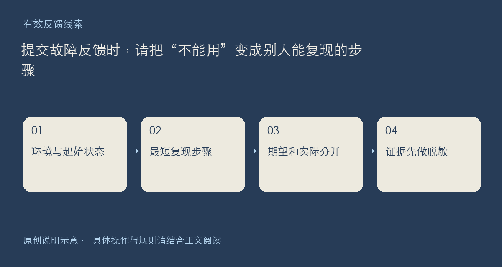

想反馈一个故障，不需要先知道原因。比起猜测后台哪里出错，一条可以照着操作的复现路径更有帮助。这个主题用于征集具体、可验证的问题；它不是已确认缺陷清单，也不表示每条现象都已经被复现。

## 请按这条路线描述

先写使用入口：网页、小伴桌面还是手机端；再写产品版本、系统版本与相关页面链接。随后说明初始状态，例如刚登录、列表为空、已有一项收藏。把操作拆成短步骤，避免一句“正常使用就出问题”包含许多可能路径。

接着分开写期望与实际。例如期望刷新后出现空态提示，实际看到空白区域；这只是写法示例，不代表本站已经发生该故障。记录发生时间、出现频率，以及重新打开后是否仍出现，有助于区分稳定复现和偶发网络问题。

可附截图、脱敏日志或最小文件，但不要上传整份私人配置。截图尽量保留提示文字和相关按钮，裁去昵称、邮箱、令牌及无关窗口；日志要先检查认证头和文件路径里的私人信息。

建议回复中包含：入口与版本、起始状态、具体步骤、期望结果、实际结果、频率、已尝试的方法。若后来发现了新的条件，请在同一条反馈中补充变化，方便上下文连起来。涉及账号或隐私材料时，按[社区规则](https://chat.xiangban.xyz/rules)提供的联系渠道提交必要信息。

