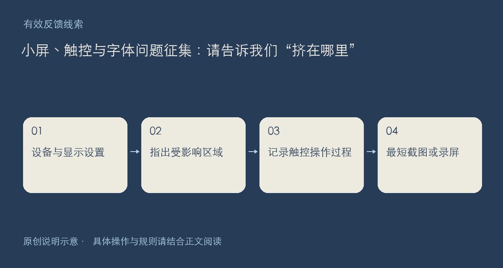

界面能打开，不代表在每种屏幕上都能顺畅使用。欢迎反馈手机横竖屏、浏览器缩放、系统字体变化或触控时遇到的问题。这里征集的是实际观察，不需要把正常差异都写成故障，也不要求你为了反馈安装测试工具。

## 哪些信息最能帮助定位

请写设备型号、系统与客户端版本，以及当时是横屏还是竖屏。网页还可以补充浏览器名称和缩放比例；如果自己调大了系统字体，也请说明。接着指出具体位置：某个按钮被遮住、长标题把列表撑宽，还是输入框唤起键盘后无法看到提交按钮。

截图最好保留足够上下文，让人知道正在看哪个页面和哪个区域，同时裁去私人内容。若问题只有滑动或点按时出现，可以按顺序描述手指动作、页面如何变化、哪一步无法继续；录屏只需覆盖最短过程，不必录下整个桌面。

也欢迎说明一个临时可用的办法，例如切换方向后能否完成操作。但请把它标为暂时绕法，不要把猜测写成产品的正式使用要求。图像没有问题而文字截断，也请保留原文字长度，便于判断是内容边界还是布局问题。

可按“设备与显示设置—页面链接—受影响区域—操作过程—实际阻碍—可否绕过”回复。公开材料应先脱敏；关于账号与数据的处理说明见[隐私政策](https://chat.xiangban.xyz/privacy)。

