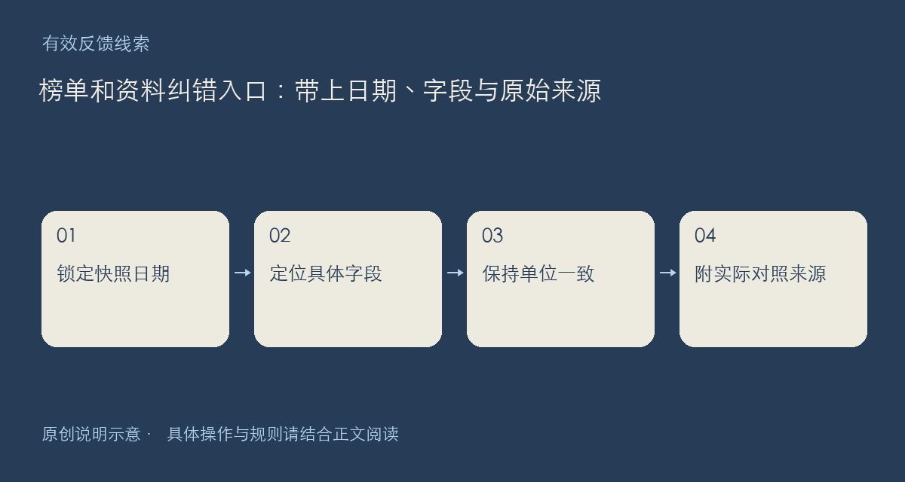

看到榜单数字、模型名称或资料链接不对，欢迎提出纠正。最有帮助的反馈不是“这个排名不靠谱”，而是指出哪一份公开快照、哪个条目、哪个字段，与哪份来源存在差异。不同日期和不同统计口径不能直接拼在一起比较。

## 建议先核对四件事

记录页面的统计日期与更新时间；复制模型标识、项目名称或资料标题；指出具体字段及页面显示值；再附你实际看过的原始来源和其中对应的位置。若来源后来更新，请说明新旧时间，避免把正常更新差异误判成一次采集错误。

能力评测、价格、输出速度与 Token 用量各有含义。纠错时请同时写单位和适用条件，例如输入与输出价格不要混用，也不要把某个完整 UTC 日的用量与当前时刻的累计数据直接相减。遇到没有显示的字段，可以说明来源是否真的提供该项，不必替缺失值猜一个零。

资料入口问题则请区分打不开、跳转错误、内容过期和主题不匹配。留下起始页面与目标地址，能减少来回询问。若只能看到部分来源，请明确说自己只核对了哪些内容，而非断言整张榜都已失效。

请在回复中写“页面与日期、条目标识、疑点字段、对照来源、建议更正”。这不是要求你提前证明所有原因，只是让站方能准确重查同一个问题。查看入口：[模型榜](https://chat.xiangban.xyz/models)。

