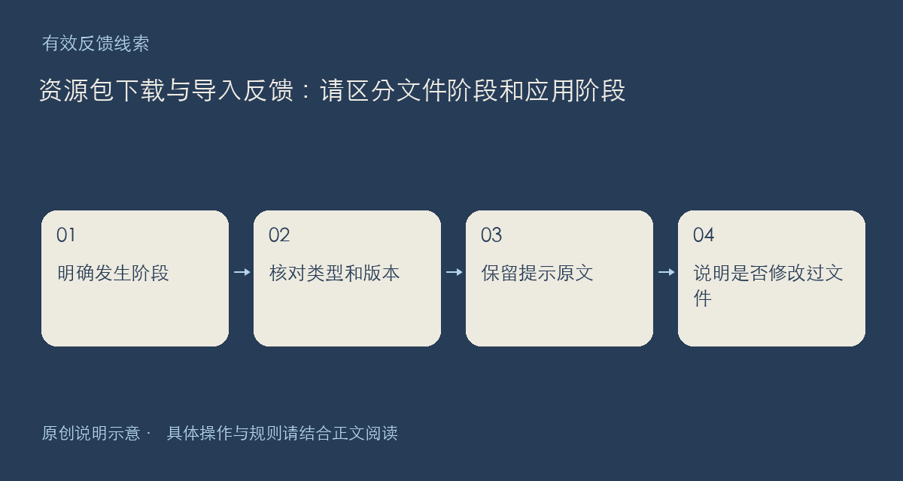

资源包出现问题时，先确认卡住的是哪一段：找不到下载入口、下载未完成、ZIP 解压失败、客户端导入被拒绝，还是导入后没有出现在预期位置。这些现象需要的材料不同，分开描述比反复重新下载更容易定位。

## 先读类型，再记录错误

请附作品详情链接、类型、版本和下载时显示的文件大小；有校验值时一并保留。说明使用了哪个客户端与版本，是否更改过文件名、重新压缩或手动修改包内文件。不要把文件扩展名改成另一种类型来尝试“兼容”。

壁纸、特效、组件和游戏有各自的包结构。日常流程、提醒、任务、目标、技能、专家、工作流这批作品明确作为手动模板提供，下载不会自动生成系统任务。若你的预期是自动运行，也请写出来，方便区分使用方式误解与真正的导入故障。

遇到导入拒绝，优先保留完整提示文字和最少操作步骤；遇到下载损坏，说明是否完整下载、是否在另一网络下仍一致。有条件时可比较公开校验值，但不要为测试执行来源不明的脚本，更不用把自己的账号凭据贴出来。

建议按“作品链接—类型版本—客户端环境—发生阶段—提示原文—是否改包—已尝试方法”回复。附件只上传有权分享且不含私人数据的最小材料；原始唯一文件请继续在本机保留。

入口：[作品首页](https://chat.xiangban.xyz/)；分享边界见[社区规则](https://chat.xiangban.xyz/rules)。

