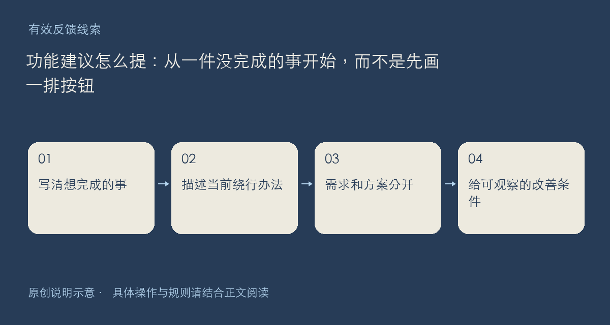

欢迎提出新功能，也欢迎说明现有功能让你绕了哪些路。为了让建议更容易评估，这个主题优先收集实际场景：你想完成什么、现在怎样做、在哪一步付出了额外成本。无需先写一份完整需求文档，也不必证明所有用户都有同样需要。

## 一条建议可以只回答五个问题

你是什么角色，正在做哪件事？你期望最后得到什么结果？目前使用了哪些入口或临时办法？最影响完成的一个障碍是什么？怎样的变化会让你判断问题得到改善？这几个答案比单独说“加个智能模式”更容易形成可讨论的目标。

如果已有实现想法，可以附在场景后面，并与实际需求分开。例如先说明希望快速找回刚收藏的作品，再讨论排序、筛选或快捷入口。这样即使具体按钮方案不合适，原本的问题仍然能被保留下来。

也请写出频率和约束：这是偶尔发生，还是每次都要做；能否接受手动步骤；是否需要跨端；哪些数据不能上传。不要为了增强说服力编造其他用户的评价，自己的真实一次经历已经有价值。

反馈会作为讨论材料，不等同于开发排期、上线时间或服务承诺。已有相似主题时，可以补充不同场景，避免只重复投票式回复。涉及个人账号和隐私材料，请使用规则页列出的联系渠道，而不是放进公开需求示例。

依据：[社区规则](https://chat.xiangban.xyz/rules)与[隐私政策](https://chat.xiangban.xyz/privacy)。

