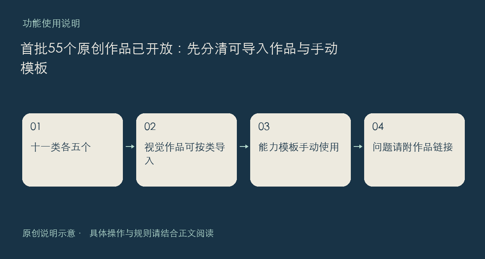

社区首批原创作品已经公开，覆盖特效、壁纸、组件、游戏，以及日常流程、提醒、任务、目标、技能、专家、工作流，共十一类，每类五个。它们都提供实际下载文件，作品详情中的说明比类型名称更重要，建议先读完再决定怎样使用。

## 两种使用方式

前四类共二十个视觉作品按桌面资源包格式制作。壁纸是自包含动画页面，特效是粒子数据，组件使用无需脚本的网页交互，游戏支持鼠标或触控。下载后仍需在对应位置导入；导入只是收进作品库，不代表立刻更换桌面或启动游戏。

其余三十五个是明确标注的手动模板，包含工作页、结构化数据、填写示例和提示词。例如下班收尾模板帮助记录停在哪一步，反馈复现模板帮助整理环境与证据。下载这些文件不会自动创建提醒、任务或后台工作流，请解压后按说明填写、复制或阅读。

## 建议这样开始

先挑一个与你眼下需要有关的作品，核对类型、版本、文件大小及使用边界。游戏和组件不承诺保存本次输入或进度，重要记录应另行保存。若下载或导入失败，请保留作品链接与错误提示，到建议反馈板块说明具体步骤，避免只留一句“不能用”。

入口：[作品首页](https://chat.xiangban.xyz/)；分享与使用仍遵守[社区规则](https://chat.xiangban.xyz/rules)。

