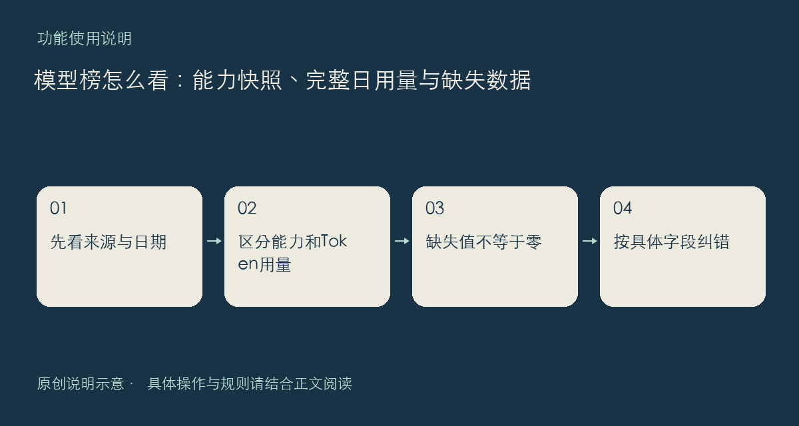

模型能力榜和模型调用量榜已经开放。两张榜回答的问题不同：能力榜整理来源提供的评测、价格与性能字段；调用量榜展示 OpenRouter 来源的完整日 Token 用量。后者不能直接当作独立用户数、请求次数，或全行业的市场份额。

## 比较前先对齐口径

请先看来源、统计日期和页面显示的更新时间，再看排序。一次采集完成的时间不等于每项评测的原始发生时间；某个模型没有某项数据，也不等于成绩或价格为零。筛选指标后，只能在实际有该字段的条目之间作相应比较。

日榜使用完整的 UTC 自然日，因此你所在时区已进入新一天时，最新公开榜单仍可能标为前一天。切换日期有助于看清同一口径下的变化；只有相邻日期均有公开数据，名次变化才有对应的比较基础，不宜自行把缺页补成零。

来源采集已有定时更新机制，但采集失败、校验或来源缺数都可能使页面保留上一份有效快照。这里不承诺每次刷新都有新数据，也不建议只凭一个名次选定模型。最好带上自己的任务、预算和延迟要求，进一步做小规模验证。

发现错误时，请记录模型名称或标识、具体字段、日期和来源证据，再到建议反馈说明。入口：[模型榜](https://chat.xiangban.xyz/models)与[调用量榜](https://chat.xiangban.xyz/models?board=usage)。

