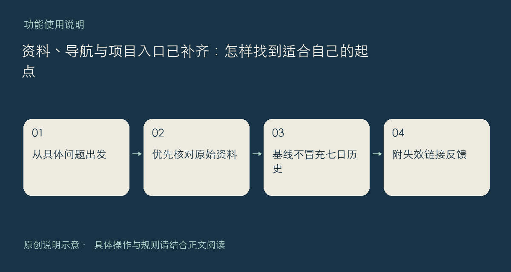

社区资料区已整理 Claude、Codex、SkillHub 三组入口，每组五项；导航中也整理了不同来源的工具入口。它们用于帮助寻找原始文档和使用起点，不能替代对应服务自己的说明，也不意味着社区为第三方账号、价格或长期可用性作担保。

## 按问题找入口

准备学习某个工具时，先写出自己要完成的一个动作，例如理解工作区、查看命令说明，或了解技能文件结构。再选能直接回答这个问题的原始文档，留意文档日期、适用产品和版本。不要把同名功能在不同产品中的行为直接视为一致。

项目与周刊入口也已有公开内容。项目更适合了解一个方向的用途和链接，周刊适合按一期内容集中浏览。看到感兴趣的内容后，可继续打开原始来源核对上下文；一份整理稿不应被误当作对全部资料的完整收录。

本次开源项目页同时提供真实采集快照。首日记录首先是观测基线，尚不能由此推算完整七天增长；显示观察不足时，请不要把它转述成“七日新增排名”。

如果某个入口失效，反馈中请附上你点开的页面、目标链接和当时看到的结果。若只是内容覆盖不到你的学习目标，也欢迎说明“想解决什么、已有哪份材料、缺哪一步”，这比单独要求再加几个链接更方便整理。

入口：[社区首页](https://chat.xiangban.xyz/)、[项目](https://chat.xiangban.xyz/?tab=projects)、[周刊](https://chat.xiangban.xyz/?tab=weekly)。

