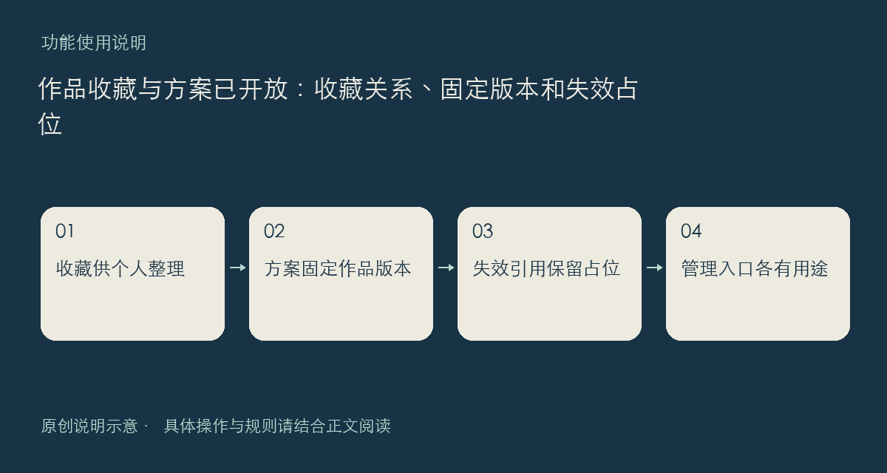

现在可以在作品、方案详情中收藏自己想再看的内容，也可以把公开作品组成方案。首批五个公开方案已经可查看。收藏是个人整理入口；方案是带有作者、简介和作品引用的公开内容，两者用途不同，不会因为收藏一次就替你安装作品。

## 一份方案保存了什么

方案引用指向选定作品及其版本。这样，作者讨论的组合不会无声地改成另一套新版本。查看方案时，仍需逐项读原作品说明，确认用途和限制；把多个项目放进方案，不会额外授予其中作品的转载、执行或分发权。

收藏列表会按当前公开状态展示内容。作品下架、作者封禁，或关联内容不再公开后，原有收藏不会继续作为公开访问的通道。方案中的不可用引用会留下占位，而不是继续展示旧标题和可点击入口。遇到占位，不能直接判断是作者主动调整还是管理处理。

自己的作品和方案可到“我的作品”管理，收藏内容则从作品收藏入口查看。作者下架公开内容，与已经下载到自己设备的文件是两回事；本地文件的使用仍受原许可与安全边界约束，不能因文件还在就继续公开传播已失效链接。

发现收藏状态不同步时，请说明登录账号是否一致、操作来自网页还是客户端、具体作品与发生时间，先不要靠重复点击制造更多状态变化。

入口：[全部方案](https://chat.xiangban.xyz/schemes)、[我的作品](https://chat.xiangban.xyz/me/works)、[作品收藏](https://chat.xiangban.xyz/me/content-bookmarks)。

