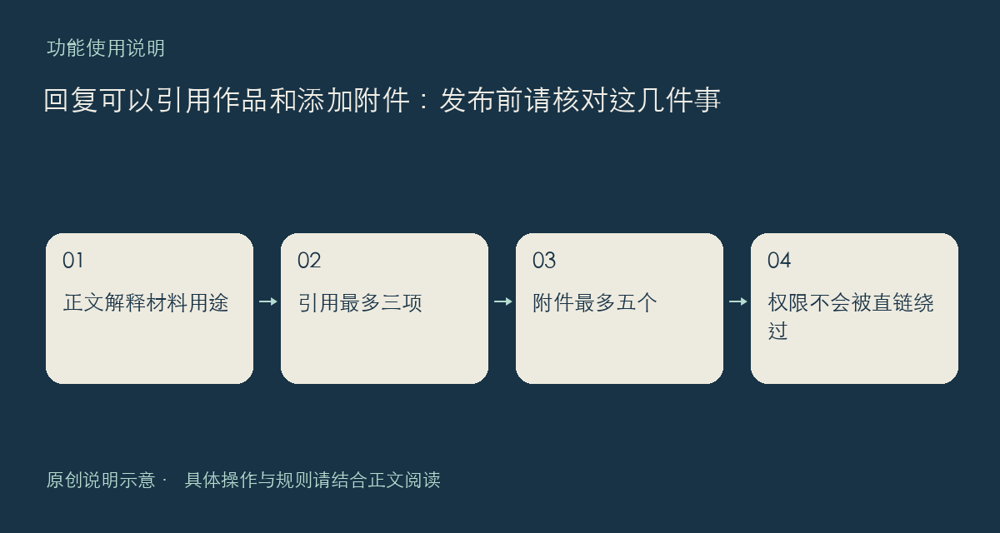

讨论问题时，回复现在可以附上作品或方案卡片，也可以关联自己上传的附件。比起只写一个模糊名称，卡片能指向具体内容；比起把长日志铺满楼层，附件更适合提供必要的脱敏材料。正文仍应说明它们与问题有什么关系。

## 作品卡与附件分别怎么用

一条回复最多引用三项作品或方案，新增引用必须是公开可读内容。内容包省略版本时，会固定为发表时实际存在的当前版本，不会随作者后续上新自动换成另一份文件。原作品后来不可用时，卡片显示占位，不能借回复绕过原内容状态。

附件最多五个，只能关联本人尚未使用或本回复已使用的附件，不能挪用其他人的文件。附件可沿用零至十分的下载价格；付费项要先确认购买，同一附件已有购买记录后重复下载不再重复收费。积分支付不会突破帖子自身的阅读权限。

提交前请确认文件名、版本和脱敏范围，等待上传结束后再发表。回复被隐藏、删除，或相关内容不可见时，附件直链也不是继续访问的旁路。需要保留的唯一原件请在自己的设备另存，论坛附件不应成为唯一备份。

遇到问题时，反馈应区分“上传失败”“发表时关联失败”“下载失败”与“已购买但打不开”，并附相关楼层链接和提示。不要在公开日志里留下访问令牌、验证码或私人文件内容。

使用入口在具体帖子下方；权限与内容边界参见[社区规则](https://chat.xiangban.xyz/rules)。

