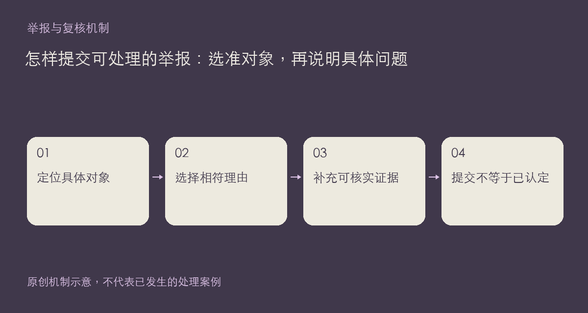

这个板块发布举报机制说明，不是虚构处罚案例的展示区。发现疑似违规内容时，请使用对应帖子、回复、作品或方案的举报入口，指出具体对象和理由；对某个人的笼统不满，不能替代可核实的内容线索。

## 提交时怎样组织材料

先确认要举报的是主帖、某一楼回复，还是一个独立作品。回复问题请保留楼层链接；作品问题请保留详情地址及版本。随后选择与实际情况最接近的理由，例如广告推广、账号或 Key 交易、人身攻击、侵权等，再用补充说明指出哪一段、哪张图或哪个文件存在疑点。

说明尽量写可观察的行为。例如列出疑似推广入口出现的位置，而不是用“这个人肯定是骗子”替代证据。涉及隐私时不要把原始敏感信息再次贴到公开回复里；必要材料只通过对应的受保护入口或规则页列出的联系渠道提供。

举报提交后仍需要核实，数量多不代表自动成立，也不应动员他人围攻。界面显示提交成功，表示已接收这次操作，不等于已经作出处罚决定。本站没有在这篇说明中新增处理时限或保证某一种结果。

如果内容后来发生变化，可保留当时看到的位置与时间，补充具体差异。对规则本身有疑问，可先阅读[社区规则](https://chat.xiangban.xyz/rules)；对实际管理处理有异议，使用其中说明的申诉渠道。

