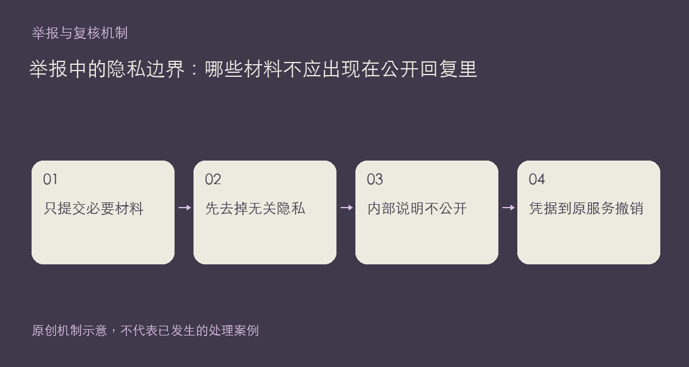

举报往往需要证据，但证据不应成为第二次传播隐私的理由。公开楼层里贴完整聊天记录、邮箱、手机号、访问令牌或私人文件路径，可能让无关信息进一步扩散。这里说明的是现有入口和材料整理方式，并不是对任何具体用户作出违规认定。

## 留下必要上下文，删去无关身份信息

截图应保留与争议相关的原文、位置和时间线索，遮去无关昵称、头像、联系方式和认证信息。日志只截取能解释问题的部分；若出现自己的有效密钥，先去原服务撤销或更换，再处理截图，单纯打码旧图片不能让已泄露凭据失效。

作品和方案举报的理由、补充材料以及管理员内部说明不向内容作者公开。普通用户也不能通过公开页面读取别人的举报记录。需要联系站方时，不要因为看不到内部记录就把敏感原件重新发在公示板块；可以保留本地副本，通过规则页提供的渠道说明相关链接。

本站会为提供论坛功能保存相应的内容与行为记录，具体收集范围、用途及权利说明以隐私政策为准。这里不把“未公开展示”说成“从不保存”，也不承诺任何系统绝对安全。

一份实用材料通常包括内容地址、问题位置、发生时间、脱敏截图和简明说明；只交足以核实的部分。若需要额外信息，应先确认对方使用的是正式联系渠道，不发送密码和验证码。

依据：[隐私政策](https://chat.xiangban.xyz/privacy)及[社区规则](https://chat.xiangban.xyz/rules)。

