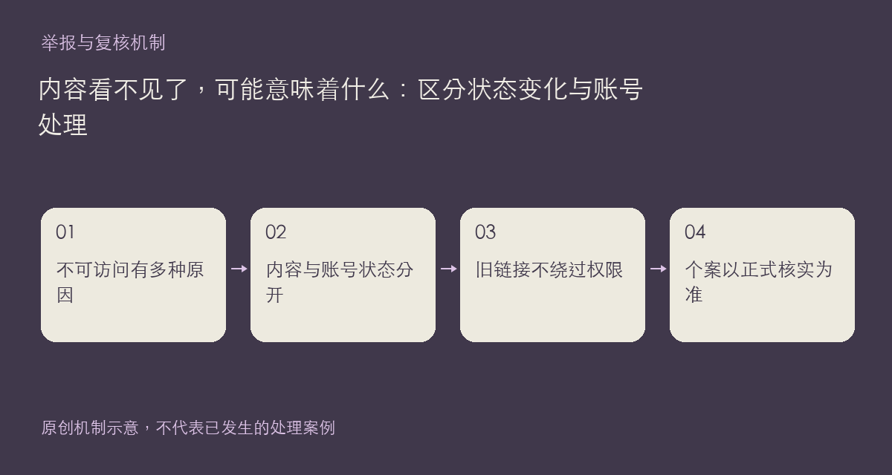

看到一个链接无法打开，不能立即推断作者被处罚。内容可能由作者下架、被管理隐藏、受到阅读权限限制，或因账号状态变化而不再公开。公开页面呈现的是当前可访问结果，不是一份完整的管理裁决记录。

## 先分清对象和操作

帖子与回复的隐藏、删除，作品与方案的下架，以及账号的禁言、封禁，是不同层面的状态。举报处理入口可以对相关内容采取措施；账号措施需要相应的管理操作，不能把一次内容下架直接等同于账号永久封禁。

作品下架后，收藏和方案引用也会按当前状态更新。失效卡片留下占位，回复附件也不能依靠旧直链绕过回复的可见性。相反，已经下载到本机的文件不会因为页面消失就自动从设备删除；它是否可以继续使用或再次分发，仍要看原授权和实际情况。

当前社区规则说明了删除内容、禁言、封号等后果，也保留申诉渠道；不应从别人的页面表现推测未经公开的举报理由、身份信息或管理过程。更不要据此在其他楼层发起点名、围攻或补写所谓处理案例。

如果变化发生在自己的内容上，请记录内容链接、时间和实际看到的通知，先核对“我的作品”或相关页面；仍有异议时按规则联系站方。本文只解释状态差异，不新增处罚标准，也不公布任何未经核实的个案。

正式依据：[社区规则](https://chat.xiangban.xyz/rules)与[用户协议](https://chat.xiangban.xyz/terms)。

