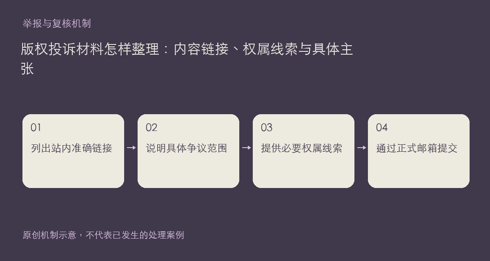

如果你认为站内内容侵犯了自己的版权，现有社区规则提供了邮件投诉渠道：support@xiangban.xyz。请说明主张权利的内容、站内对应链接，并提供权属证明和联系方式。这个主题帮助整理材料，不代替对某一作品授权关系的具体判断。

## 一份便于核实的邮件

邮件标题可以概括为“版权投诉＋站内内容标题”。正文先列出相关帖子、楼层或作品详情地址，再描述涉及哪一段文字、哪张图片或哪个文件。随后提供能支持权利主张的原始发表页面、授权材料或其他必要线索，并说明它们与争议内容的关系。

如果你是受托人，请交代代理身份及相应依据；如果争议只是部分引用，也请指明范围，不要把整站或整类内容笼统列为侵权。可说明希望核查、纠正来源或处理的具体对象，但不能把个人要求当作已经生效的站方结论。

不要把完整身份证件、私人合同或无关联系人信息发到公开评论区。必要证明可通过邮件提交，同时保留自己的原件和发送记录；是否还需补充材料，以实际核实过程为准。无法确认某个附件是否应公开时，先用文字说明，不要为证明权属再次扩散受保护内容。

具体处理安排请查看规则页的现行说明，本文不另外增加回复时限或保证投诉必然成立。若你只是普通读者发现来源疑点，也可以先使用内容举报入口指出位置与原始来源。

依据：[社区规则中的版权投诉说明](https://chat.xiangban.xyz/rules)。

