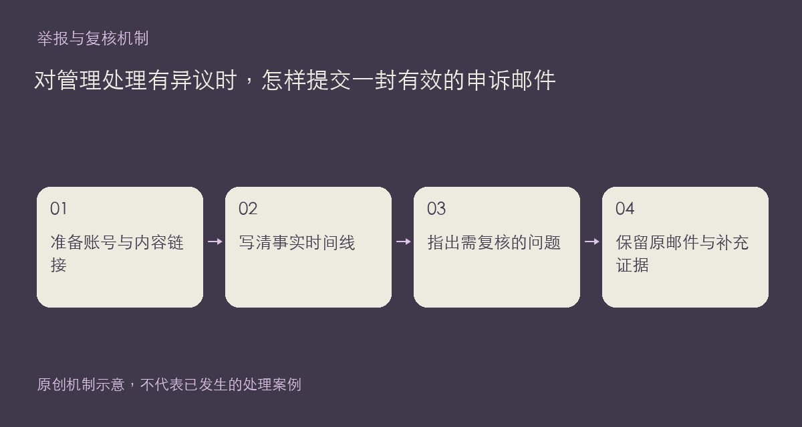

现有规则与用户协议都提供了申诉渠道：support@xiangban.xyz。如果你认为自己的内容或账号被误处理，可以按这个渠道联系站方。申诉的作用是让具体问题有机会重新核对，不是保证原操作一定撤销，也不需要在公开板块披露私人证明。

## 把一次处理说明白

建议邮件包含账号昵称、相关内容链接、发现状态变化的时间，以及自己实际看到的提示或通知。随后用简短时间线说明原内容的用途、你认为可能存在误解的位置和希望重新核对的问题。尽量把事实与猜测分开，不要用大量无关争论覆盖关键信息。

有新证据时，请说明它支持哪一点。例如能够证明素材授权的来源，或能够解释某段上下文的原始记录；这只是材料类型说明，不代表本站已经发生了这些个案。只提交核实所需部分，不发送密码、验证码或仍然有效的密钥。

如果暂时不能登录或发帖，邮件仍是规则中列出的联系办法。保留自己发送的邮件与必要材料；补充同一事项时，可沿用原邮件主题把变化说清楚，避免把同一事实拆成许多缺少上下文的独立请求。

公开规则可能更新，判断依据应以现行页面和实际处理说明为准。不要因为其他人的表面经历，就假定自己的情况必然适用同一结果。若问题涉及个人信息处理，也可在邮件中明确指出对应疑问，便于分别核对。

参考：[社区规则](https://chat.xiangban.xyz/rules)、[用户协议](https://chat.xiangban.xyz/terms)、[隐私政策](https://chat.xiangban.xyz/privacy)。

