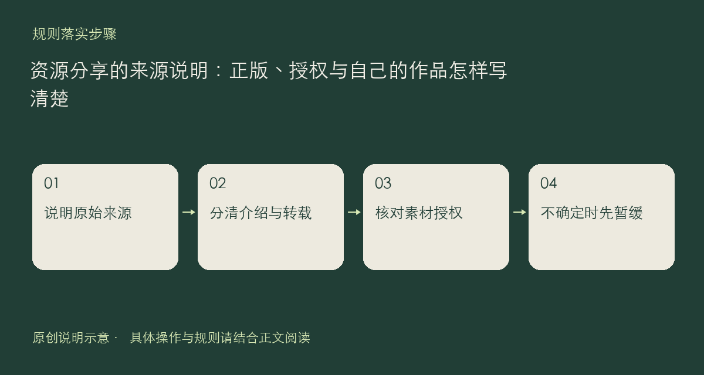

资源分享首先要说明内容来自哪里、自己凭什么可以分享。精品软件可以介绍正版、开源和免费软件；片单、歌单与评论可以讨论作品内容；课程、文档和学习笔记应来自可以公开的来源。这里并不接收破解软件、盗版下载或付费课程的破解转存。

## 一篇介绍至少交代三件事

第一，给出原作者或项目名称及原始页面。第二，说明你分享的是评价、官方入口、授权文件，还是自己的原创作品。第三，写清适用平台、版本和已知限制。只写“网上找到”不足以让读者判断来源，也不应把“免费下载”自动理解为“可以任意转载”。

引用别人的段落、截图或图形时，请注明出处，并遵守对应许可或授权范围。可以用自己的话解释用途和差异，不要把整篇内容搬过来只在末尾补一个链接。自己的作品也应检查是否夹带他人素材、密钥、私人记录或无权分发的字体与文件。

如果不能确认文件能否公开，先改成介绍原始官方页面，或暂缓上传；不要把不确定的授权结论包装成站方保证。权利人若认为内容侵犯其版权，可按规则页提供的邮箱与材料要求提出投诉，由站方核实。

这篇只是帮助把已有要求落实到发帖步骤，不新增许可、不替具体作品作法律结论。正式处理依据与后续调整请以[社区规则](https://chat.xiangban.xyz/rules)及[用户协议](https://chat.xiangban.xyz/terms)为准。

