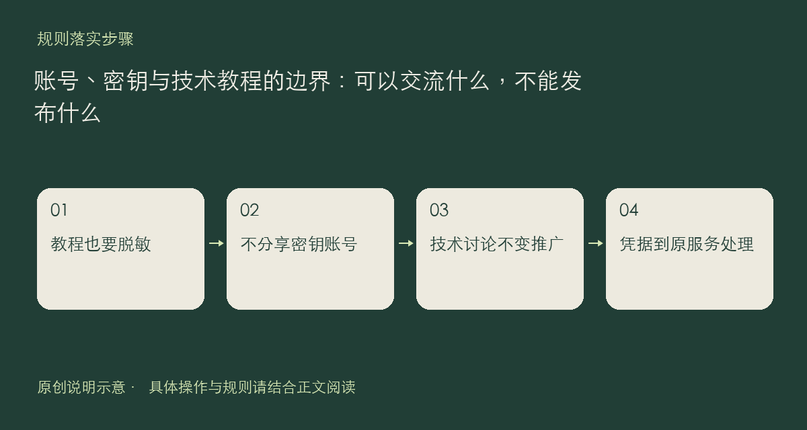

技术交流可以讨论实现思路，但不能把讨论变成账号交易、密钥分发或服务推广。现有规则明确禁止分享或买卖 API Key、共享或买卖账号，以及传播批量注册脚本。自己的测试密钥也不应因为“只是演示”就出现在截图、配置或附件里。

## 教程先做一次脱敏检查

准备贴配置时，检查认证头、访问令牌、手机号、邮箱及不应公开的服务地址。密钥位置可以写成明确的占位文字，并告诉读者从自己获授权的环境配置；不要留下看似删去一半、实际上仍能使用的凭据。日志也可能包含这些信息，不能只检查正文。

自建中转的技术教程可在 AI 大模型板块讨论部署开源项目、配置思路等技术内容，但不能拉人使用自己运营的服务，不能贴可用中转地址、Key 或收费入口。运营、出售、推广中转与付费代理，及规则所列的翻墙教程、机场推广，都在禁止范围内。

第三方服务怎样注册、收费和限制使用，应查看它自己的条款；社区中的信息收录不是对其安全或持续运营的担保。不要因有人自称客服或站务，就把验证码、密码或付款信息交给对方。

发现疑似凭据泄露时，先停止继续传播；若是自己的凭据，应到对应服务撤销或更换，再提交必要的脱敏反馈。具体边界与账号要求请看[社区规则](https://chat.xiangban.xyz/rules)和[用户协议](https://chat.xiangban.xyz/terms)。

