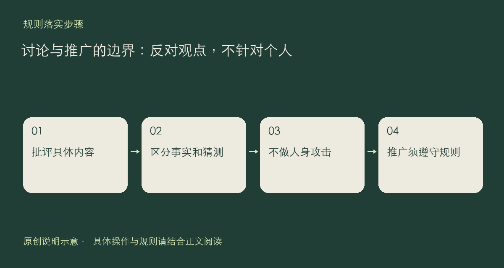

社区欢迎不同经验和观点，但反对意见应落在内容本身。可以指出某个方法不适合自己的环境，给出版本、步骤和依据；不要把技术分歧升级为辱骂、人身攻击、开盒，或围绕地域、性别等身份制造对立。规则同样禁止时政引战内容。

## 让批评保留可讨论的对象

与其写“作者根本不懂”，不如说明“这一步在某个版本返回了什么结果”。区分自己观察到的事实、对原因的猜测与个人偏好。引用别人观点时保留上下文，不把一个短句裁成与原意相反的意思。需要举报时使用入口，不动员他人围攻或挖掘身份。

私人推广也有明确边界：个人邀请链接、带推广参数的链接，以及推广自己的产品或服务，不因包装成经验分享就自动获得例外。站方自己的产品介绍集中在小伴产品板块；站方发布或合作的推广内容应明确标注赞助，不能伪装成用户爆料。

闲聊分类也有各自范围。例如“亏了吗”用于交流盈亏经历和心态，不用于荐股、给具体买卖点、拉群带单、收费咨询或投资产品推广。换个分类不意味着这些限制失效。

发出回复前，检查一句话：别人能否根据这段内容补充证据、解释差异，或修正问题？若只能引起对人的争执，先改写再发。本文依据[社区规则](https://chat.xiangban.xyz/rules)，不另设新的处罚档次。

