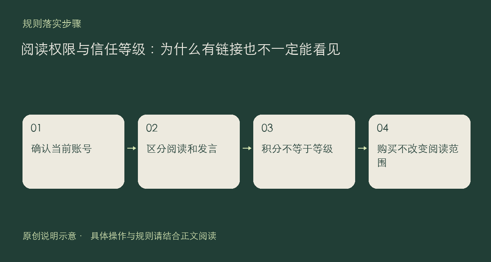

社区的阅读范围与发言权限不是同一件事。一个账号能够打开公开帖子，并不意味着能查看所有受限主题；拥有某个链接，也不代表自动获得相应阅读资格。理解这个区别，可以减少“朋友看得到、我打不开”一类误判。

## 先看当前账号和帖子范围

帖子可以设置为所有人、成员以上、老用户以上或守护者可见，作者能设置的上限受自身等级约束。没有权限的人不会在普通列表、搜索和用户主页里看到相应内容，直接打开链接也可能得到权限提示；作者查看自己的帖子另有对应规则。

信任等级用于控制部分访问和发言能力，积分则用于站内积分功能，二者不能混为一谈。新人可参与的发帖分类、外链与图片权限，以及升级条件，请查看规则页与当前账号界面；不要只凭余额推断自己已解锁了某种权限。

附件的购买同样不改变主题的阅读范围。把受限内容的地址转给别人，或把已经付费下载的文件重新公开上传，并不会为接收者补上权限或授权。需要合作处理问题时，先确认哪些材料可以公开，必要时整理一份脱敏后的独立说明。

如果认为权限异常，请附账号当前等级、页面链接、完整提示和登录入口，不要公开访问令牌。管理人员需要这些信息区分未登录、等级不足、内容状态变化与真正故障。依据见[社区规则](https://chat.xiangban.xyz/rules)和[隐私政策](https://chat.xiangban.xyz/privacy)。

