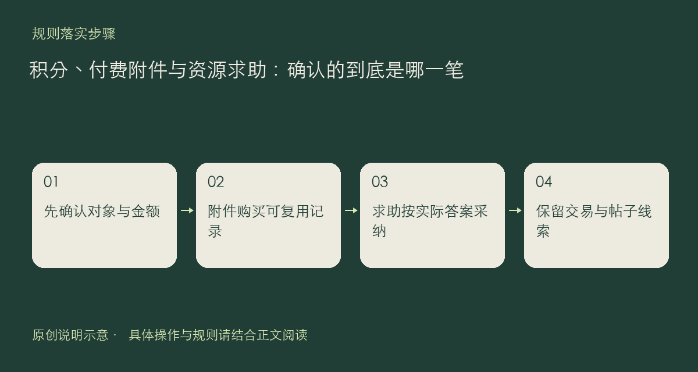

积分是社区内的记录与使用机制，不等同于信任等级，也不能替代内容授权。当前附件可以设置零至十分的下载价格；资源求助可以使用积分悬赏。使用前请看清对象、金额和确认提示，别把“参与一次讨论”理解为必然会获得某种回报。

## 附件购买与悬赏是两种事情

付费附件由你在购买时确认，已有购买记录后，同一附件重复下载不会再次收费。若价格变化，先刷新并重新核对，不要连续重复确认。购买不绕过原帖阅读权限，也不意味着允许转售或再次公开分发附件。

资源求助则围绕一个具体问题和可接受的答案。提问时应写清合法来源要求、适用平台、已有尝试和验收条件；不能用悬赏索要破解软件、盗版课程或账号密钥。采纳应对应真正解决问题的回答，不用互刷或虚假互动取代实际帮助。

完成采纳后，回答会保留原文，不能把它当作随时可反悔的临时标记。关闭、到期与退款按页面及现有流程处理；看到处理尚未完成时，先保留求助链接和操作时间，再检查记录，而不是重复创建同一笔操作。

出现疑问，请到积分记录和相关帖子分别核对“哪笔、哪个对象、何时确认”。公开反馈应隐去不必要的个人资料。具体使用说明以当前界面、[社区规则](https://chat.xiangban.xyz/rules)和[用户协议](https://chat.xiangban.xyz/terms)为准。

