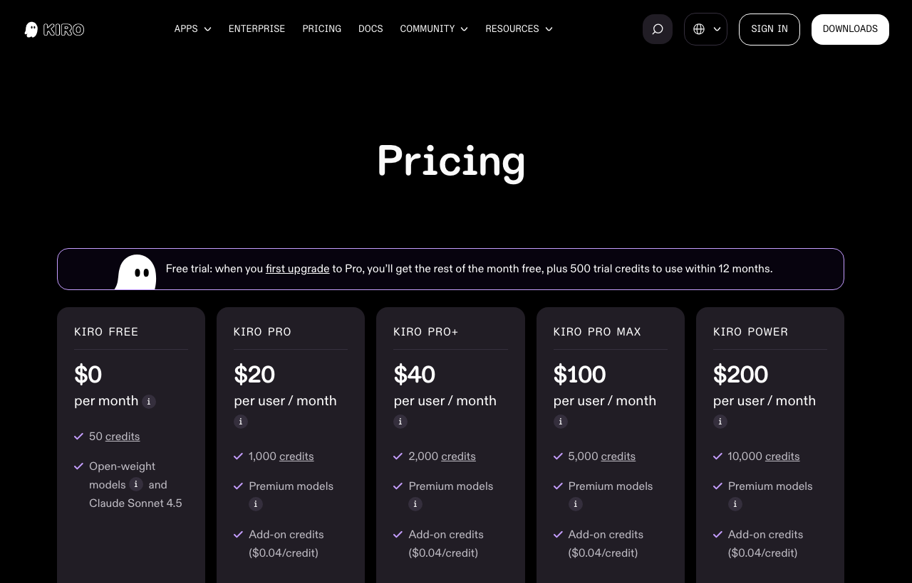

Free 账号第一次升级 Pro（原价 `$20/月`），当月剩下的天数直接 `$0` 免单，除掉套餐本身的 1000 额度，还额外多送 500 Trial Credits（一年有效）。升完就能在里面直接切 Claude Opus 5.5、Sonnet 5.5、GPT-5.6 这些主力模型用。

注意它的套餐额度是按当月剩余时间**精确到秒折算**的，下个月 1 号才扣第一笔钱。比如 15 号开只能拿半个月套餐额度（约 533）+ 500 赠金，**月初 1 号开最爽**，能直接吃满 1000 + 500。不打算续费的话记得月底前退回 Free（退回去后没用完的 500 赠金还在，但就只能调免费模型了）。

官方说明：[Kiro 新版试用公告](https://kiro.dev/blog/kiros-new-free-trial-gives-you-500-extra-credits/) · [定价页](https://kiro.dev/pricing/)
