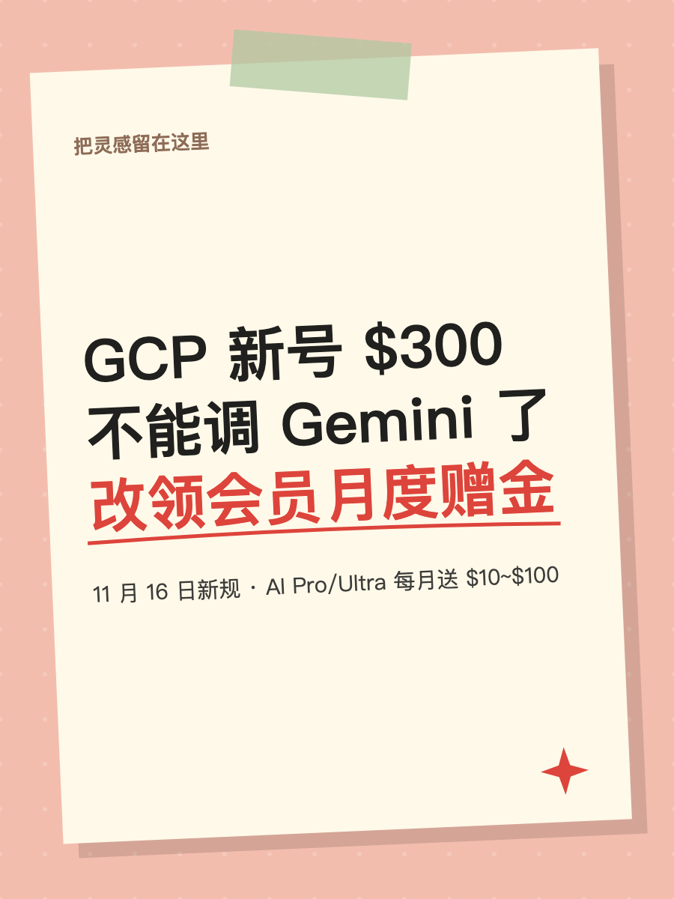
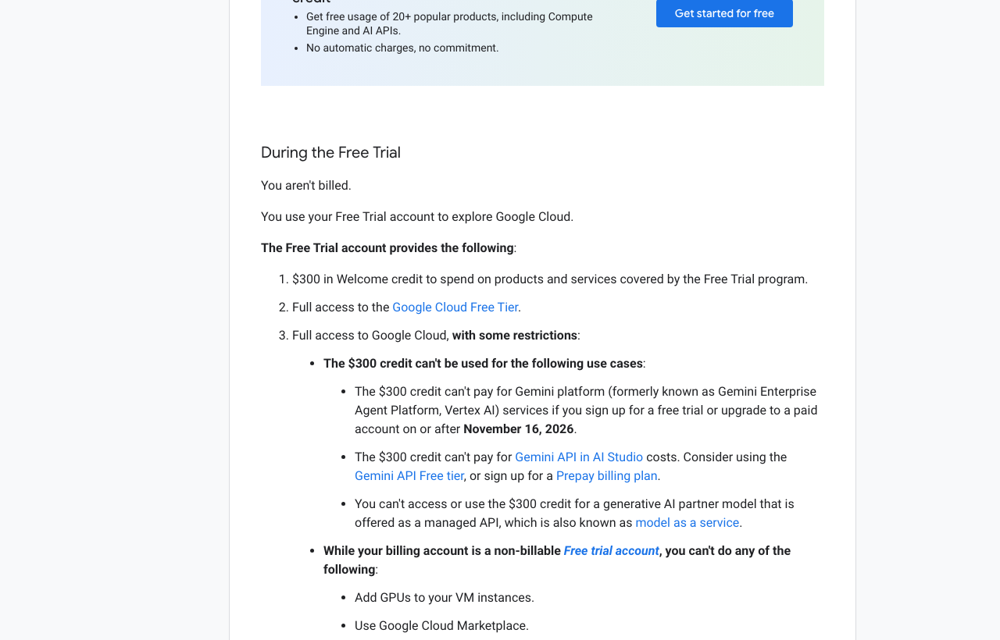

提醒下还在注册 GCP 新号刷 Gemini API 的，官方 11 月 16 号刚改了条款，**新号送的 `$300` 试用赠金已经不能用来抵扣 Vertex AI（Gemini platform）和 AI Studio 的 API 费用了**，只能拿去开小鸡或者跑常规云服务。

现在想免费调 Gemini API，要是你已经开了 **Google AI Pro 或 Ultra 会员**，记得去 Google Developer Program 领每月附带的 Cloud 额度（**Pro 每月送 `$10`、Ultra 5x 送 `$40`、20x 送 `$100`**）。进 AI Studio 绑一下账单就能直接抵扣 Gemini API，当月用不完还能往后攒 12 个月。

新规页面：[Google Cloud 免费试用条款](https://docs.cloud.google.com/free/docs/free-cloud-features?hl=en) · [Google AI Studio](https://aistudio.google.com/)
