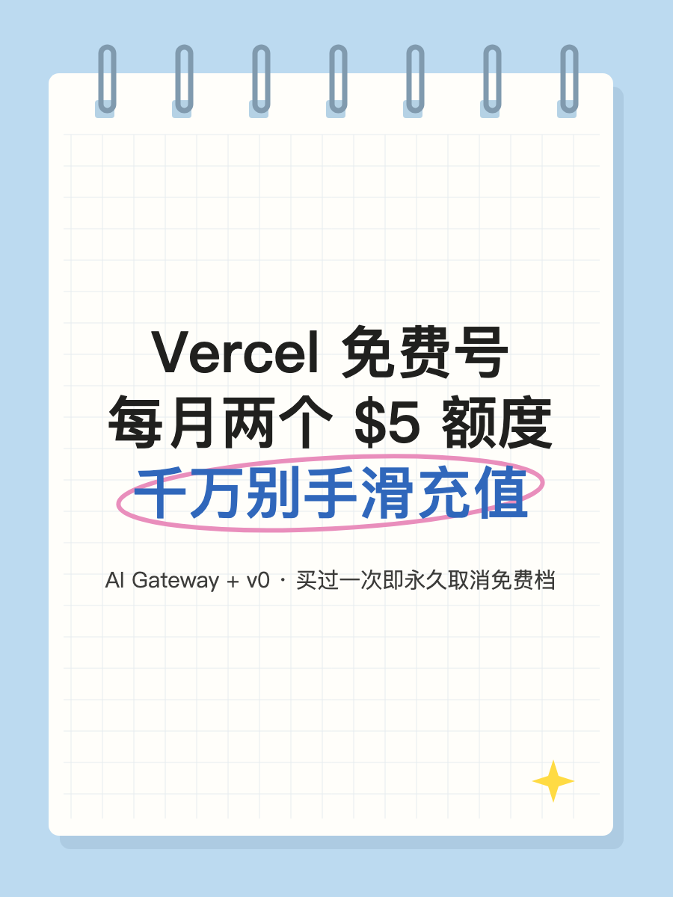
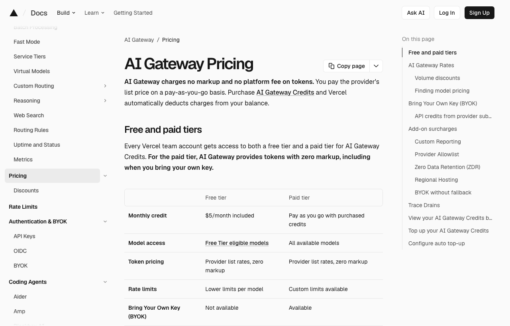

平时用 Vercel Hobby 免费号部署前端的，账号里其实自带两笔每个月自动刷新的 `$5` 额度：

一个是控制台里的 **AI Gateway**，Free 档每月给 **`$5` 额度**，可以调 Free 档支持列表里的模型，按上游原价扣不加价。**但有个巨坑的设定：只要你主动充值买过哪怕一次 Credits，账号就会切到付费档，以后每个月这 `$5` 免费额度直接没收！** 想一直用这 `$5/月` 的话，千万别点充值，也别开自动续费（另外 Free 档暂不支持自带 Key BYOK，付费档才开放）。

另一个是 **v0.app**，免费档每个月也会刷新 **`$5` Credits**，平时拿来随手生成几个前端组件刚好够用。

文档地址：[Vercel AI Gateway 定价](https://vercel.com/docs/ai-gateway/pricing) · [v0 定价页](https://v0.app/pricing)
